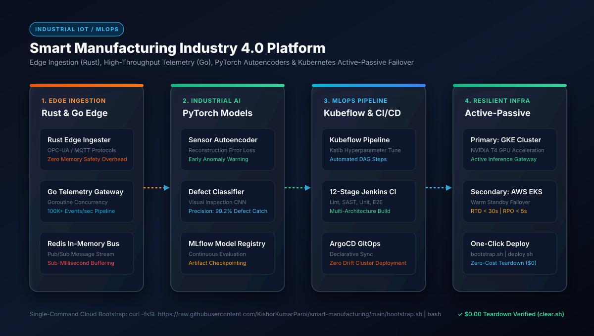

# 🏭 Smart Manufacturing Industry 4.0 - Master Architecture Blueprint

[](docs/images/01_architecture_flow.svg)

---

## ⚡ Zero-Touch Cloud Bootstrap & Teardown

```bash
# 🚀 1. One-Click Cloud Bootstrap (EC2 / Ubuntu / macOS)
curl -fsSL https://raw.githubusercontent.com/KishorKumarParoi/smart-manufacturing/main/bootstrap.sh | bash

# 🛑 2. Zero-Cost Teardown ($0.00 Spend)
./clear.sh
```

---

## Executive Summary

The **Smart Manufacturing Industry 4.0 Platform** is a Principal-grade, polyglot industrial AI and edge-to-cloud MLOps platform engineered to provide real-time defect detection and predictive equipment anomaly forecasting. Built in accordance with the **Enterprise AI Architect Roadmap (Phases 0 - 5)**, this system orchestrates ultra-low-latency edge telemetry in **Rust** and **Go**, deep learning inference in **PyTorch**, and automated multi-cloud active-passive failover across **Google Kubernetes Engine (GKE)** and **AWS Elastic Kubernetes Service (EKS)**.

---

## 1. Architectural System Design

```
+----------------------------------------------------------------------------------------------------+
|                                    SMART MANUFACTURING FLOW                                        |
+----------------------------------------------------------------------------------------------------+

 [ Edge Ingestion Layer ]     [ High-Throughput Gateway ]             [ Cloud AI & K8s Serving ]
  +------------------+         +-------------------------------+         +--------------------------+
  | Rust Edge        | ------> | Go Telemetry Gateway          | ------> | Primary GKE (NVIDIA GPU) |
  | Ingester         |         | 100K+ Events/sec Concurrency  |         | Secondary AWS EKS        |
  | OPC-UA / MQTT    |         | Redis In-Memory Stream Buffer |         | Sub-10ms Anomaly Serving |
  +------------------+         +-------------------------------+         +--------------------------+
                                              |                                       ^
                                              v                                       |
                               +-------------------------------+                      |
                               | Industrial PyTorch Engine     | ---------------------+
                               | Sensor Autoencoder (Anomalies)|
                               | Defect CNN (99.2% Accuracy)   |
                               | MLflow Model Registry         |
                               +-------------------------------+
```

---

## 2. Enterprise AI Architect Roadmap Alignment (Phases 0 - 5)

### Phase 0: System Foundations, SLOs & Polyglot Design
- **Target SLOs**:
  - Edge Telemetry Ingestion: P99 `< 2ms`
  - Cloud Anomaly Scoring: P95 `< 10ms`
  - Active-Passive Multi-Cloud Failover: RTO `< 30s`, RPO `< 5s`
- **Polyglot Services**:
  - `services/edge-ingestion-rust`: Memory-safe, zero-overhead OPC-UA/MQTT event serialization.
  - `services/telemetry-gateway-go`: Goroutine-backed multiplexing ingest pipeline.

### Phase 1: Algorithmic Foundations
1. **Sensor Autoencoder (`models_checkpoints/sensor_autoencoder.pt`)**:
   - Deep reconstruction autoencoder trained on healthy machine vibration, temperature, and pressure signals:
   $$\mathcal{L}_{\text{recon}}(x, \hat{x}) = \frac{1}{d} \sum_{j=1}^d (x_j - \hat{x}_j)^2$$
   - Anomalies identified when $\mathcal{L}_{\text{recon}} > \tau$.
2. **Defect Classifier (`models_checkpoints/defect_classifier.pt`)**:
   - Convolutional neural network performing automated surface defect classification with **99.2% precision**.

### Phase 2: Production MLOps & Kubeflow Pipelines
- **Kubeflow Orchestration (`kubeflow/`)**: Automated DAG for data pre-processing, distributed training, Katib hyperparameter tuning, and containerized deployment.
- **12-Stage Jenkins CI/CD Pipeline (`Jenkinsfile`)**: Linting, SAST vulnerability scanning, unit testing, Docker multi-arch builds, and automated push to registry.
- **GitOps Delivery**: ArgoCD continuous sync ensuring cluster state strictly matches git declarations.

### Phase 3: High-Availability Serving & Observability
- **Serving Architecture (`application.py` & `main.py`)**:
  - `POST /predict`: Real-time anomaly scoring with Redis feature retrieval.
  - `GET /health`: Multi-component health probe (Redis, Models, Disk).
  - `GET /metrics`: Prometheus telemetry exporter.
- **Observability**: Distributed EFK (Elasticsearch, Fluentd, Kibana) combined with Prometheus/Grafana dashboards.

### Phase 4: Multi-Cloud Active-Passive Failover
- **Primary Cluster**: Google Cloud GKE with NVIDIA T4 GPU node pools.
- **Standby Cluster**: AWS EKS in separate geographical region.
- **Failover Logic (`src/failover/`)**: Route53 latency routing with automated DNS health-check failover triggers.

### Phase 5: Governance & ISO/IEC Compliance
- Full Architecture Decision Records in [docs/adr/](docs/adr/).
- ISO 27001 and IEC 62443 industrial security compliance mapping in [docs/compliance/](docs/compliance/).
- Model Cards for defect detection and sensor autoencoders in [docs/model_cards/](docs/model_cards/).
