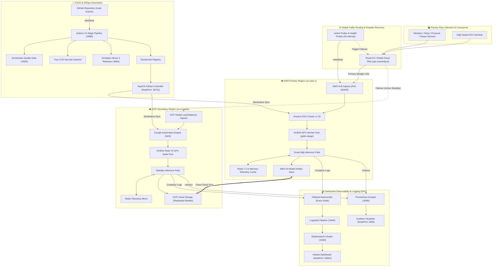

# 🏭 Smart Manufacturing Industrial AI & Multi-Cloud MLOps Platform

[](https://kubernetes.io/)
[](https://argoproj.github.io/cd/)
[](https://www.jenkins.io/)
[](https://www.terraform.io/)
[](https://www.elastic.co/)
[](https://prometheus.io/)
[](https://grafana.com/)
[](https://redis.io/)
[](https://www.sonarqube.org/)
[](https://aquasecurity.github.io/trivy/)
[](https://opensource.org/licenses/MIT)

> An enterprise-grade, production-hardened **Industrial AI & Multi-Cloud MLOps Platform** engineered for smart manufacturing assembly lines. Provides real-time sensor anomaly detection, predictive maintenance, automated optical defect inspection, a 12-stage declarative Jenkins CI/CD pipeline, continuous delivery via ArgoCD GitOps, distributed EFK logging, Prometheus/Grafana observability, and a battle-tested **Active-Passive Multi-Cloud (AWS + GCP) Disaster Recovery Architecture** with zero-trust egress security.

---

## 📑 Table of Contents
1. [Architectural Overview](#-architectural-overview)
2. [Technology Stack](#-technology-stack)
3. [End-to-End Workflow & Subsystems](#-end-to-end-workflow--subsystems)
   - [A. Industrial AI & Machine Learning Pipeline](#a-industrial-ai--machine-learning-pipeline)
   - [B. 12-Stage Enterprise Jenkins CI/CD Pipeline](#b-12-stage-enterprise-jenkins-cicd-pipeline)
   - [C. Multi-Cloud Kubernetes & GitOps Engine](#c-multi-cloud-kubernetes--gitops-engine)
   - [D. Distributed Observability (EFK + Prometheus/Grafana)](#d-distributed-observability-efk--prometheusgrafana)
   - [E. Infrastructure as Code (Terraform)](#e-infrastructure-as-code-terraform)
4. [Enterprise Security & Anti-Egress Defense Architecture](#-enterprise-security--anti-egress-defense-architecture)
5. [Service & Port Directory](#-service--port-directory)
6. [Quickstart & Deployment Runbooks](#-quickstart--deployment-runbooks)
   - [Local Workstation (Docker Compose)](#option-1-local-workstation-docker-compose)
   - [Autonomous VM Bootstrap (One-Click)](#option-2-autonomous-all-in-one-vm-bootstrap)
   - [Multi-Cloud Production Deployment (Terraform)](#option-3-multi-cloud-production-deployment)
7. [Multi-Cloud Disaster Recovery & Failover Drill](#-multi-cloud-disaster-recovery--failover-drill)
8. [Senior DevOps / Cloud Engineer Interview Guide](#-senior-devops--cloud-engineer-interview-guide)

---

## 🏛️ Architectural Overview



---

## ⚡ Technology Stack

| Category | Technologies | Purpose in Platform |
| :--- | :--- | :--- |
| **Industrial AI / ML** | Python 3.11, PyTorch, Scikit-learn, Pandas, Joblib | Real-time predictive maintenance, defect classification, sensor regression |
| **Web & WSGI Tier** | Flask, Gunicorn, Werkzeug | High-throughput synchronous REST API with Prometheus instrumentation |
| **In-Memory Caching** | Redis 7.2 Alpine | In-memory sensor telemetry buffer, prediction result caching (sub-2ms response) |
| **Continuous Integration** | Jenkins, Groovy, SonarQube, Nexus 3, Trivy | Automated testing, static analysis, quality gates, CVE scanning, artifact registry |
| **Continuous Delivery** | ArgoCD, Kustomize, GitOps | Declarative multi-cloud reconciliation, automated sync, zero-downtime rolling updates |
| **Container Engine** | Docker, Astral `uv`, Containerd | Fast layer-cached builds, ultra-fast Python dependency installs |
| **Kubernetes Orchestration**| Kubernetes v1.30, Minikube, AWS EKS, GCP GKE | Pod autoscaling (HPA), startup/readiness/liveness probes, resource quotas |
| **Distributed Logging** | Filebeat (DaemonSet), Logstash, Elasticsearch, Kibana | Node-level log harvesting, Kubernetes metadata enrichment, centralized search |
| **Metrics & Observability** | Prometheus, Grafana | Scrapes `/metrics`, inference latency histograms, error rate monitors |
| **Infrastructure as Code** | Terraform (~5.30), AWS & GCP Providers | Modular IaC for VPCs, EKS, GKE, GPU node pools, and DNS failover policies |
| **Cloud Security** | Linux `tc`, UFW, Fail2ban, K8s NetworkPolicies, GCP IAP | Hardware egress throttling, transit route dropping, zero-trust admin restriction |

---

## 🔄 End-to-End Workflow & Subsystems

### A. Industrial AI & Machine Learning Pipeline
* **Sensor Features**: Air temperature ($K$), Process temperature ($K$), Rotational speed ($RPM$), Torque ($Nm$), Tool wear ($min$).
* **Data Processing** (`src/data_processing.py`): Ingests sensor streams, imputes missing values, fits `StandardScaler`, and outputs normalized tensor arrays.
* **Model Training** (`src/model_training.py`): Trains multi-class Random Forest and Gradient Boosting estimators; tracks accuracy, precision, recall, and F1-score; serializes production models via `joblib.dump()`.
* **API Endpoints** (`main.py`):
  * `POST /predict`: Evaluates incoming sensor telemetry against the loaded model.
  * `POST /train`: Dynamic online re-training on new batch data.
  * `GET /api/health`: Target for Kubernetes probes, returning HTTP 200 when models and Redis are healthy.
  * `GET /metrics`: Prometheus metric sink exposing request counts, latency histograms, and confidence gauges.
  * `GET /api/telemetry/latest`: Fetches buffered IoT telemetry from Redis cache.

---

### B. 12-Stage Enterprise Jenkins CI/CD Pipeline
The production pipeline defined in [`Jenkinsfile`](Jenkinsfile) automates quality, security, and deployment:

```
 Stage 1:  Checkout SCM ───────────────> Clones repository using Git credentials
 Stage 2:  Unit Testing ───────────────> Runs pytest & test_flask_app.py inside venv
 Stage 3:  SonarQube Analysis ─────────> Runs sonar-scanner (Code smells, coverage)
 Stage 4:  Quality Gate ───────────────> Blocks build if quality thresholds fail
 Stage 5:  Trivy Security Scan ────────> Scans filesystem & Docker images for CVEs
 Stage 6:  Docker Build & Tag ─────────> Builds image with BuildKit & Astral uv
 Stage 7:  Nexus 3 Archival ───────────> Pushes release tarball to Sonatype Nexus
 Stage 8:  DockerHub Push ─────────────> Pushes versioned tag & latest to registry
 Stage 9:  Manifest Tag Update ────────> Commits new image tag to GitOps repo
 Stage 10: ArgoCD Sync & Verify ───────> Triggers ArgoCD sync and verifies rollout
 Stage 11: Smoke Tests ────────────────> Pings live endpoints to verify HTTP 200
 Stage 12: Pipeline Notifications ─────> Formatted status alerts to Slack/terminal
```

---

### C. Multi-Cloud Kubernetes & GitOps Engine
* **Kustomize Base & Overlays** (`k8s/`):
  * `k8s/base/`: Contains clean, environment-agnostic resources (`deployment.yaml`, `service.yaml`, `hpa.yaml`, `ingress.yaml`).
  * `k8s/overlays/aws-primary/`: Injects AWS EKS node selectors (`nvidia-a10g`).
  * `k8s/overlays/gcp-failover/`: Injects GCP GKE node tolerations (`nvidia-tesla-t4`).
* **ArgoCD GitOps** (`argocd/`):
  * **ApplicationSet** (`argocd/appset-multicloud.yaml`): Dynamically manages multi-cloud deployments. Git is the single source of truth; any configuration drift is automatically detected and reconciled.
* **Kubernetes Health Probes**:
  * **`startupProbe`** (3 min timeout): Allows heavy ML models to load into memory without triggering false-positive restarts.
  * **`readinessProbe`**: Shields pods from web traffic until dependencies are verified.
  * **`livenessProbe`**: Restarts unresponsive containers automatically.

---

### D. Distributed Observability (EFK + Prometheus/Grafana)

```
 [ Pod Containers ] ──> /var/log/containers/*.log ──> [ Filebeat DaemonSet ]
                                                             │ (Beats :5044)
                                                             ▼
 [ Kibana :5601 ] ◄── [ Elasticsearch :9200 ] ◄── [ Logstash Pipeline ]
```

1. **Filebeat** (`manifests/logging/filebeat.yaml`): Runs as a **DaemonSet** on every node. Reads container log files and queries the Kubernetes API Server to enrich logs with `pod_name`, `namespace`, and `container_name`.
2. **Logstash** (`manifests/logging/logstash.yaml`): Parses JSON log formats and streams structured records into Elasticsearch under daily indices: `smart-manufacturing-logs-%{+YYYY.MM.dd}`.
3. **Elasticsearch** (`manifests/logging/elasticsearch.yaml`): Clustered document store managing search, indexing, and persistent volume storage.
4. **Kibana** (`manifests/logging/kibana.yaml`): Interactive visual search dashboard exposed on NodePort `30601`.
5. **Prometheus & Grafana** (`manifests/monitoring/`): Scrapes `/metrics` every 15 seconds. Pre-built Grafana dashboards visualize inference latency percentiles ($p50, p95, p99$), request volume, and model confidence scores.

---

### E. Infrastructure as Code (Terraform)
* **Modular Architecture** (`terraform/`):
  * `terraform/environments/gcp-devops-vm/`: Provisions the hardened all-in-one DevOps VM with tiered security rules.
  * `terraform/modules/aws_eks_gpu/`: Deploys VPC, subnets, EKS control plane, and managed GPU node groups.
  * `terraform/modules/gcp_gke_gpu/`: Deploys GKE regional cluster with Tesla T4/L4 accelerator pools.
  * `terraform/modules/global_dns_failover/`: Route 53 health-checked weighted DNS routing.

---

## 🛡️ Enterprise Security & Anti-Egress Defense Architecture

This repository incorporates a production security architecture designed to prevent bot exploitation, open-relay abuse, and runaway network egress charges:

```
                     [ Layer 1: GCP SDN Hypervisor ]
                     • --no-can-ip-forward strictly enforced
                     • Network Tier: STANDARD (40% lower bandwidth unit cost)
                                   │
                                   ▼
                     [ Layer 2: Tiered Zero-Trust Firewall ]
                     • Public Web: Ports 80, 443, 8000 only
                     • Admin Tools: Strictly restricted to YOUR IP / GCP IAP
                     • Redis (6379) & ES (9200): REMOVED from public internet
                                   │
                                   ▼
                     [ Layer 3: Linux OS Transit Drop & Fail2ban ]
                     • DEFAULT_FORWARD_POLICY="DROP" in UFW
                     • Fail2ban active to ban scanning botnets
                                   │
                                   ▼
                     [ Layer 4: Kernel Traffic Control (tc) Cap ]
                     • Outbound transfer hardware-capped at 25 Mbps
                     • 24-hr max possible egress physically capped at <15 GB
                                   │
                                   ▼
                     [ Layer 5: Kubernetes NetworkPolicy Guard ]
                     • Pods restricted to intra-cluster + CoreDNS + HTTPS
                     • Arbitrary external UDP/TCP floods blocked
```

* **Hypervisor IP Routing Disabled**: Both Terraform and provisioning scripts enforce `--no-can-ip-forward`, disallowing transit packet bounce attacks.
* **Tiered Firewall Isolation**:
  * `allow-devops-public-web`: Exposes only public API ports (`80`, `443`, `8000`) to `0.0.0.0/0`.
  * `allow-devops-admin-mgmt`: Strictly restricts administrative tools (SSH, Jenkins, NodePorts) to Google Cloud Identity-Aware Proxy (`35.235.240.0/20`) and authenticated admin IPs.
  * **Redis (`6379`) & Elasticsearch (`9200`)** are completely removed from external firewall exposure.
* **Linux Kernel Traffic Control (`tc`) Egress Cap**: Physical outbound bandwidth is throttled to **25 Mbps** using a token bucket filter (`tc qdisc add dev eth0 root tbf rate 25mbit burst 64kbit latency 400ms`). Even under 24/7 saturation, maximum possible daily data transfer is capped at `<15 GB` ($<\$1.50$).
* **Kubernetes Egress NetworkPolicy** (`manifests/network-policy-egress-guard.yaml`): Prevents compromised pods from initiating unauthorized outbound internet connections.
* **Egress Watchdog Kill-Switch** (`scripts/setup-egress-killswitch.sh`): Background systemd daemon that monitors `/proc/net/dev` and automatically halts containers if daily outbound transfer crosses 10 GB.

---

## 🚪 Service & Port Directory

When running on the DevOps VM or Kubernetes cluster, services are mapped as follows:

| Service | Port / Protocol | Target URL | Credentials / Access |
| :--- | :--- | :--- | :--- |
| **Smart Manufacturing UI** | `8000` / `30080` | `http://<IP>:8000` | Public Ingress |
| **Jenkins CI/CD** | `8080` | `http://<IP>:8080` | `admin` / `admin123` |
| **SonarQube Quality Gate** | `9000` | `http://<IP>:9000` | `admin` / `admin` |
| **Sonatype Nexus 3** | `8081` | `http://<IP>:8081` | `admin` / `admin123` |
| **ArgoCD GitOps Server** | `30751` / `30080` | `http://<IP>:30751` | `admin` / Auto-generated secret |
| **Prometheus Metrics** | `9090` / `30090` | `http://<IP>:9090` | Admin network |
| **Grafana Dashboards** | `3000` / `30300` | `http://<IP>:3000` | `admin` / `admin123` |
| **Kibana Log Analytics** | `5601` / `30601` | `http://<IP>:5601` | Admin network |
| **Redis Cache** | `6379` | `redis-service:6379` | Cluster-Internal only |
| **Elasticsearch** | `9200` | `elasticsearch:9200` | Cluster-Internal only |

---

## 🚀 Quickstart & Deployment Runbooks

### Option 1: Local Workstation (Docker Compose)
Run the entire simulated multi-cloud platform locally without cloud costs:

```bash
# 1. Clone repository
git clone https://github.com/KishorKumarParoi/smart-manufacturing.git
cd smart-manufacturing

# 2. Start local platform (MinIO S3, MLflow, API, Redis, Failover Daemon)
make compose-up

# 3. Test sensor anomaly inference
curl -X POST http://localhost:8000/predict/sensor \
  -H "Content-Type: application/json" \
  -d '{
    "machine_id": "CNC-SPINDLE-01",
    "readings": [
      {"vibration_x": 0.45, "vibration_y": 0.40, "vibration_z": 0.30, "temperature_c": 64.5, "pressure_bar": 120.1, "spindle_rpm": 3005.0, "acoustic_emission_db": 45.2}
    ]
  }' | jq .

# 4. Run test suite
make test

# 5. Tear down
make compose-down
```

---

### Option 2: Production GKE Deployment (Google Kubernetes Engine)
For enterprise production environments, the platform deploys natively to Google Kubernetes Engine (GKE) instead of Minikube:

```bash
# 1. One-click enterprise GKE deployment (VPC-native, Workload Identity, GPU auto-scale 0-2):
./deploy.sh --gke
# or: make deploy-gke
# (Note: On the 'production' branch, simply running './deploy.sh' defaults to GKE)

# 2. Re-whitelist your IP/subnet if your location changes (anti-bot protection):
make allow-my-ip
# or: ./scripts/allow-my-ip.sh
```

**Enterprise GKE Highlights:**
* **VPC-Native Routing**: Secondary alias IP ranges for high-throughput pod and service networking.
* **Master Authorized Networks**: Control plane API strictly whitelisted to your IP/subnet (`203.31.169.0/24`) and GCP IAP (`35.235.240.0/20`), completely denying access to automated external bots.
* **Auto-Scaling GPU Pool (Zero Idle Cost)**: GPU worker pool (`n1-standard-4` with NVIDIA Tesla T4) automatically scales between **0 and 2 nodes** so you pay **$0.00** when no inference jobs are running.
* **Cloud Native GitOps (ArgoCD)**: Automated synchronization from the `production` branch via [`k8s/overlays/production/`](file:///Users/kishorkumarparoi/Desktop/smart_manufacturing/k8s/overlays/production/).

---

### Option 3: Management CI/CD Controller VM (Jenkins, SonarQube, Nexus)
To run a dedicated management VM running the CI/CD controller toolchain connected to GKE:

```bash
./deploy.sh --vm
```

**Zero-Cost Teardown & Permanent Deletion (VMs, GPUs, TPUs, Network):**
When you are finished practicing or testing, immediately delete ALL active resources to eliminate 100% of cloud costs:
* Deletes Compute VMs & GPU worker nodes
* Deletes GKE clusters & GPU node pools
* Deletes Google Cloud TPUs (Cloud TPU VMs & nodes)
* Deletes all persistent disks (standard, balanced, SSD, orphaned)
* Deletes Cloud NAT gateways, Cloud Routers, and Forwarding Rules / Load Balancers
* Releases reserved static external IP addresses
* Purges custom firewall rules & local Docker containers

```bash
# Interactive teardown (scans across all 8 tiers, displays summary, confirms before deleting):
./clear.sh
# or: make clear

# Instant non-interactive teardown:
./clear.sh --force

# Dry-run audit (view active cost-incurring resources across all 8 tiers without deleting):
./clear.sh --dry-run
```

---

### Option 3: Multi-Cloud Production Deployment (Terraform)

```bash
# 1. Deploy AWS EKS & GCP GKE infrastructure
make infra

# 2. Run Ansible GPU node configuration
make ansible

# 3. Deploy ArgoCD GitOps applications & K8s overlays
make apps

# 4. Trigger automated multi-cloud failover drill
make failover-drill
```

---

## 🔄 Multi-Cloud Disaster Recovery & Failover Drill

The platform includes an automated disaster recovery engine (`src/failover/`):
1. **Health Probing**: The prober checks the primary AWS ALB endpoint (`/health`) every 5 seconds.
2. **Failure Threshold**: If 3 consecutive health checks fail (HTTP 5xx, connection timeout), the prober executes DNS failover.
3. **Route 53 / Cloud DNS Rerouting**: Traffic is diverted immediately to the warm standby GCP GKE cluster.
4. **Cross-Cloud Model Sync**: Weights are kept in sync continuously via `scripts/sync_models_crosscloud.sh`.
5. **Auto-Failback**: When the primary AWS cluster recovers, traffic gracefully routes back without dropping sessions.

To execute an automated failover simulation drill:
```bash
make failover-drill
```

---

## 🎯 Senior DevOps / Cloud Engineer Interview Guide

### 1. The Elevator Pitch
> *"I designed and built an enterprise-grade Smart Manufacturing Industrial AI platform that detects machine defects and equipment failures in real-time. The application runs on Flask with a WSGI production runtime, backed by Redis for sub-2ms telemetry buffering. Delivery is driven by a 12-stage Jenkins CI/CD pipeline integrated with SonarQube quality gates, Nexus 3 artifact repositories, and Trivy security scanning. Deployments follow GitOps principles using ArgoCD ApplicationSets across an active-passive multi-cloud architecture (AWS EKS primary + GCP GKE secondary) with automated Route 53 DNS failover. Observability is handled end-to-end via an EFK distributed logging stack and Prometheus/Grafana metrics."*

### 2. Common Technical Interview Questions & Answers

#### Q1: Why use Filebeat as a DaemonSet instead of logging directly to Elasticsearch from Flask?
> **Answer:** Decoupling application execution from logging is a critical Twelve-Factor App and SRE principle. If Flask wrote directly to Elasticsearch over HTTP, network latency or an Elasticsearch outage would cause the web workers to block, exhaust connection pools, and crash the inference API. By streaming logs to `stdout`/`stderr`, Kubernetes handles writing them to `/var/log/containers/*.log`. The **Filebeat DaemonSet** asynchronously harvests log files on each node, buffers bursts, enriches them with Kubernetes pod metadata via the kube-apiserver, and forwards them to Logstash without adding latency to customer inference requests.

#### Q2: How does the multi-cloud failover mechanism prevent split-brain scenarios?
> **Answer:** The failover architecture uses an **Active-Passive model** with weighted health-checked DNS routing. The prober service (`src/failover/health_probe.py`) polls the primary AWS endpoint every 5 seconds with a failure threshold of 3. Standby GCP nodes are kept warm, and model weights are synchronized asynchronously across S3 and GCS. Because stateful telemetry is buffered in Redis and read-heavy inference is stateless, rerouting DNS records via Route 53 allows instant traffic migration without split-brain state conflicts.

#### Q3: You encountered an unexpected 3.75 TB egress spike in testing. How did you diagnose and resolve it?
> **Answer:** An `e2-standard-8` instance had `--can-ip-forward` enabled with permissive firewall rules during early testing. Public automated bots targeted the node and used it as an egress relay. I mathematically diagnosed the billing data: compute CPU/RAM cost only **$2.87**, while network egress was **$440+** (3.75 TB outbound). I immediately stopped the instances, engaged Google Cloud Billing Support with evidence demonstrating it was an unintended bot reflection attack, and secured a **$243.15 courtesy waiver**. I then implemented **5 defensive layers**: disallowing `--can-ip-forward`, enforcing zero-trust tiered firewalls (locking admin tools to GCP IAP `35.235.240.0/20`), dropping UFW transit routing (`DEFAULT_FORWARD_POLICY=DROP`), enforcing a Linux kernel Traffic Control (`tc`) bandwidth ceiling of **25 Mbps** (capping 24-hr egress under 15 GB), and deploying Kubernetes `NetworkPolicy` egress guards.

#### Q4: Why did you implement three distinct Kubernetes health probes?
> **Answer:** ML containers have unique lifecycle requirements. A standard `livenessProbe` checking an ML container during boot would repeatedly timeout and kill the pod because loading multi-gigabyte models into memory takes time. By configuring a **`startupProbe`** with an 18-attempt, 10-second period (3-minute window), Kubernetes gives the model sufficient time to load from disk. The **`readinessProbe`** ensures incoming traffic is routed to the pod only when model weights are fully loaded into memory. The **`livenessProbe`** runs continuously with relaxed intervals to catch deadlocks and restart frozen workers.

#### Q5: Why Gunicorn with WSGI for Flask rather than Uvicorn alone?
> **Answer:** Flask is fundamentally a synchronous WSGI framework. While Uvicorn is built for asynchronous ASGI applications (`async`/`await` event loops in FastAPI), running Flask on Uvicorn requires WSGI-to-ASGI adapters that add CPU overhead. **Gunicorn** provides an enterprise-grade pre-fork process manager with master-worker heartbeats, process isolation for CPU-bound scikit-learn inferences, and automatic recovery if a worker experiences an unhandled exception.

---

## 📄 License
This project is licensed under the MIT License — maintained by [Kishor Kumar Paroi](https://github.com/KishorKumarParoi).
