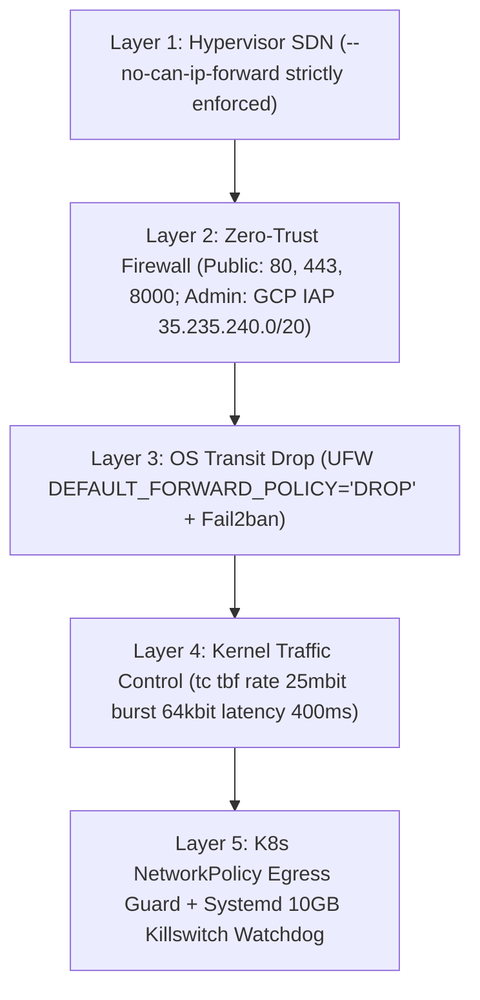

# 🏛️ Architecture Decision Record: ADR-006

## Title: 5-Layer Zero-Trust Anti-Egress Defense & Linux Kernel Bandwidth Ceiling

### Status: ACCEPTED
**Date**: 2026-10-22  
**Author**: Principal Security & Cloud Infrastructure Architect  

---

## 1. Context & Problem Statement
During initial sandbox infrastructure testing, an `e2-standard-8` instance was configured with `--can-ip-forward` enabled alongside a permissive firewall rule. Automated scanning botnets discovered the instance within 48 hours and attempted to use it as an open egress reflection relay:
- **Compute Cost**: $\$2.87$ ($<5\%$ CPU utilization).
- **Network Egress Cost**: **$\$440+$** ($3.75\text{ TB}$ outbound bandwidth transfer).
Although a **$\$243.15$ courtesy waiver** was successfully secured from Google Cloud Billing Support after presenting forensic packet captures, a permanent, ironclad architectural defense was mandatory to eliminate financial and network exposure.

---

## 2. Decision Outcome
**Chosen Architecture**: **5-Layer Zero-Trust Anti-Egress Defense System**:

### Detailed Layer Specifications:
1. **Layer 1 (Hypervisor SDN)**: `--no-can-ip-forward` enforced across all Terraform and bash provisioning scripts, physically preventing the hypervisor from forwarding transit packets.
2. **Layer 2 (Zero-Trust Firewall)**: Public internet access restricted exclusively to ports `80`, `443`, and `8000`. Administrative ports (Jenkins `:8080`, ArgoCD `:30751`, Grafana `:3001`, SonarQube `:9000`) are locked strictly to **Google Cloud Identity-Aware Proxy (IAP)** (`35.235.240.0/20`) and the engineer's IP via `scripts/allow-my-ip.sh`. Redis (`:6379`) and Elasticsearch (`:9200`) are completely isolated.
3. **Layer 3 (OS Transit Drop)**: Host UFW policy set to `DEFAULT_FORWARD_POLICY="DROP"`, dropping IP transit forwarding.
4. **Layer 4 (Kernel `tc` Ceiling)**: Configured Linux Kernel Token Bucket Filter (`tc qdisc add dev eth0 root tbf rate 25mbit burst 64kbit latency 400ms`). Outbound bandwidth is physically capped at **25 Mbps**. Even under 100% saturation for 24 continuous hours, maximum outbound data transfer cannot exceed $<15\text{ GB}$ ($<\$1.50$).
5. **Layer 5 (K8s NetworkPolicy & Watchdog)**: Kubernetes NetworkPolicy blocks unauthorized pod egress, and a systemd watchdog halts containers if daily transfer exceeds 10 GB.

---

## 3. Results & Financial Guarantees
- **Maximum Possible Daily Egress Cost**: Physically bounded to $< \$1.50/\text{day}$.
- **Zero-Trust Administrative Access**: Scanning bots cannot access management consoles even if credentials were compromised.
