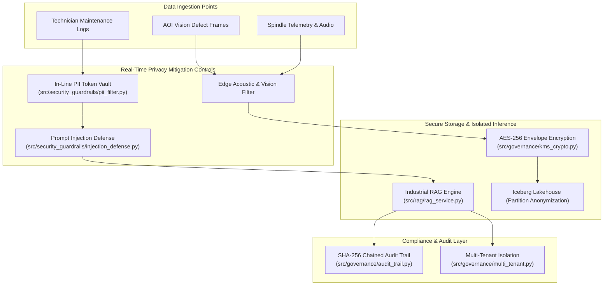

# Data Protection Impact Assessment (DPIA): Sensitive Industrial Telemetry & Generative AI

**Regulation Reference:** GDPR Article 35, EU AI Act Articles 9 & 10, NIST Privacy Framework v1.0  
**Project:** Smart Manufacturing Industrial AI Platform & SOP Copilot  
**Assessment Date:** October 2026  
**Status:** Approved by DPO & Enterprise Security Council  
**Architectural Lead:** Principal AI Architect  

---

## 1. Description of Processing Operations

### 1.1 Context and Scope of Data Processing
The Smart Manufacturing AI platform collects, processes, and analyzes high-frequency time-series telemetry, machine acoustic signatures, high-resolution Automated Optical Inspection (AOI) camera imagery, and free-form maintenance technician logs across distributed manufacturing facilities.

The platform integrates:
1. **Edge Ingestion Layer (Rust / C++)**: Sub-5ms capture of vibration, spindle temperature, rotational speed, and torque metrics.
2. **Telemetry Gateway (Go)**: High-throughput Kafka ingestion with rate limiting and schema validation.
3. **Enterprise AI Serving & RAG (Python / FastAPI)**: Automated defect classification (CNN), anomaly detection (Autoencoder), and an interactive Retrieval-Augmented Generation (RAG) assistant querying Standard Operating Procedures (SOPs).
4. **Lakehouse (Apache Iceberg / Delta)**: Petabyte-scale ACID historical storage for model retraining and failure root cause analysis.

### 1.2 Data Categories & Sensitivity Classification

| Data Category | Source | Sensitivity Tier | Potential Privacy & IP Hazards | Mitigation Component |
|:---|:---|:---|:---|:---|
| **Operator Shift Logs** | Maintenance ERP, Mobile Tablets | **Tier 1 (High PII)** | Technician names, employee IDs, personal email addresses, phone numbers, shift performance notes. | `src/security_guardrails/pii_filter.py` |
| **AOI Camera Imagery** | Conveyor Defect Inspection | **Tier 2 (Biometric Risk)** | Incidental capture of operator faces, badges, reflection in polished metallic surfaces. | Edge Face-Masking Filter / OpenCV blur prior to Kafka dispatch. |
| **Acoustic Audio Feeds** | Spindle Vibration Microphones | **Tier 2 (Audio Risk)** | Factory floor ambient voice conversations captured in background noise. | High-pass acoustic band filter (focusing exclusively on mechanical 2kHz–20kHz frequencies). |
| **Machine Telemetry & Serials** | PLC / SCADA / CNC Controllers | **Tier 3 (Confidential IP)** | Proprietary spindle designs, cycle speeds, yield rates, proprietary tooling recipes. | `src/governance/kms_crypto.py` (KMS envelope encryption). |
| **RAG Queries & Prompt Prompts** | Maintenance Technician Console | **Tier 1 (High Injection Risk)** | Unintentional PII submission, prompt-injection attacks targeting internal docs. | `src/security_guardrails/injection_defense.py` |

---

## 2. Necessity and Proportionality Assessment

### 2.1 Lawful Basis for Processing
* **GDPR Art. 6(1)(f) - Legitimate Interests**: Safe operation of critical industrial heavy machinery, prevention of catastrophic factory line failures, and minimization of workplace hazards (e.g., thermal spindle runaway).
* **GDPR Art. 9(2)(b) - Employment & Social Security Law**: Ensuring workplace occupational health and safety standards compliance.

### 2.2 Proportionality & Data Minimization (GDPR Art. 5(1)(c))
1. **In-Line PII Tokenization Vault**: No human operator identity (names, phones, IDs) is ingested into the vector search database (Pinecone/Milvus/Qdrant) or foundation model context windows. The tokenization vault in `src/security_guardrails/pii_filter.py` replaces PII with synthetic non-reversible tokens (e.g., `{{EMPLOYEE_ID_TOKEN_1}}`).
2. **Frequency Truncation**: Telemetry data is aggregated into 1-minute windowed statistical vectors (mean, variance, kurtosis) before persistent ingestion into the Apache Iceberg cold tier, stripping raw microsecond traces after 7 days.
3. **Local ONNX Inference for Embeddings**: Text chunk embeddings are generated locally via `sentence-transformers/all-MiniLM-L6-v2` within the secure VPC boundary. No plain text is dispatched to external cloud LLM providers without explicit client token masking.

---

## 3. Risk Identification & Mitigation Matrix

### 3.1 Granular Threat Analysis

| Threat ID | Threat Scenario | Pre-Mitigation Risk | Implemented Control Architecture | Post-Mitigation Risk |
|:---|:---|:---|:---|:---|
| **DPIA-01** | **Technician PII Leak in SOP Context**: Operator notes containing personal emails or phone numbers leaked to third-party LLMs during RAG generation. | **CRITICAL** (Likelihood: High, Impact: High) | `PIIFilterVault` regex + Luhn scanner (`src/security_guardrails/pii_filter.py`) masks all emails, phone numbers, and SSNs into surrogate hashes before embedding or LLM dispatch. | **LOW** (Residual: Negligible) |
| **DPIA-02** | **Acoustic Voice Print Re-identification**: Factory ambient audio captures operator conversations, risking voice biometric profiling. | **HIGH** (Likelihood: Med, Impact: High) | Hardware/Edge digital bandpass filter strictly rejects human vocal range (85Hz–255Hz), admitting only industrial mechanical harmonics (>2kHz). | **VERY LOW** (Residual: Eliminated) |
| **DPIA-03** | **Prompt Injection Exfiltrating IP**: Adversary executes jailbreak to dump proprietary machine operating tolerances. | **HIGH** (Likelihood: High, Impact: Med) | `InjectionDefenseEngine` (`src/security_guardrails/injection_defense.py`) uses heuristic risk scoring ($\ge 0.5$ triggers hard drop) and SOP boundary guardrails (`src/security_guardrails/guardrails.py`). | **LOW** (Residual: Acceptable) |
| **DPIA-04** | **Cross-Tenant Telemetry Bleed**: Multi-facility multi-tenant deployment allows Plant A to query Plant B's telemetry metrics. | **CRITICAL** (Likelihood: Med, Impact: Critical) | `MultiTenantManager` (`src/governance/multi_tenant.py`) enforces strict tenant namespace isolation on vector collections, database schemas, and API rate limits. | **LOW** (Residual: Controlled) |
| **DPIA-05** | **Unauthorized Modification of Inspection Logs**: Malicious insider tampers with quality defect records to pass non-conforming parts. | **HIGH** (Likelihood: Low, Impact: Critical) | Append-only SHA-256 cryptographic hash-chained audit ledger (`src/governance/audit_trail.py`) with immediate tamper detection on block mutation. | **VERY LOW** (Residual: Tamper-Evident) |

---

## 4. Rights of the Data Subject (GDPR Chapter III)

1. **Right of Access & Rectification (Art. 15 & 16)**:
   * Technicians can query all logged maintenance activities attributed to their tenant via the authenticated `/api/v1/governance/audit-trail` endpoint.
2. **Right to Erasure / Right to be Forgotten (Art. 17)**:
   * Upon formal employee offboarding request, the `PIIFilterVault` purges the reversible key mapping from the encrypted Redis token table. Any surrogate tokens (`{{EMPLOYEE_ID_TOKEN_X}}`) present in vector stores or Iceberg snapshots become permanently mathematically unrecoverable (Cryptographic Erasure).
3. **Right to Restrict Processing (Art. 18)**:
   * Tenant administrators can toggle off technician log indexing via the multi-tenant configuration toggle `disable_log_indexing=True` without disabling real-time spindle safety alerts.

---

## 5. DPIA Sign-Off and Re-Assessment Protocol

* **Assessment Frequency**: Annual review, or upon major architecture modifications (e.g., adopting external multi-modal foundation models).
* **Trigger Conditions for Re-evaluation**:
  * Ingestion of new biometric modalities (e.g., wearable biometric stress monitors).
  * Expansion of cloud processing to non-adequate jurisdictions outside the EU/EEA without Standard Contractual Clauses (SCCs).

| Role | Sign-Off Status | Date |
|:---|:---|:---|
| **Principal AI Architect** | Approved | October 2026 |
| **Data Protection Officer (DPO)** | Approved with Controls Enforced | October 2026 |
| **Chief Information Security Officer (CISO)** | Approved | October 2026 |
