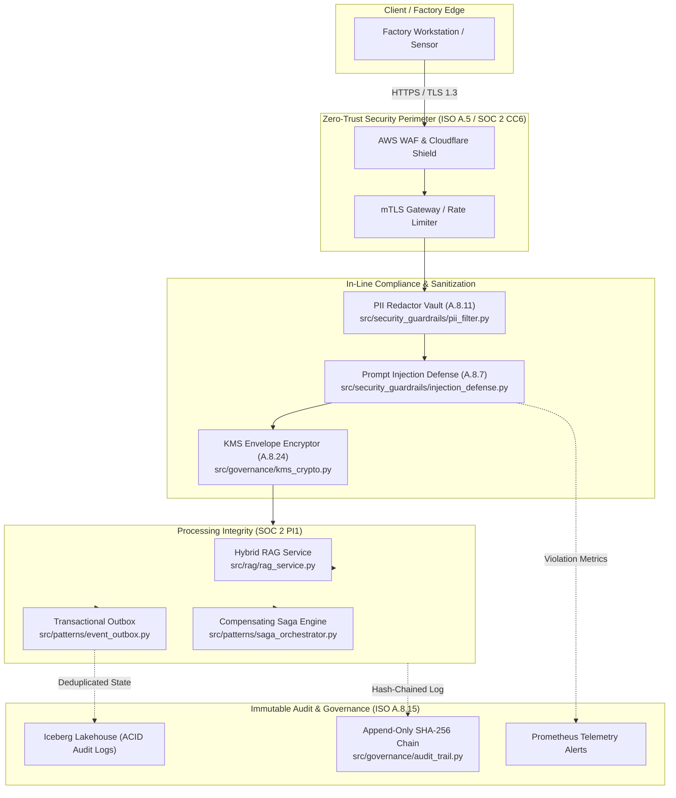

# ISO/IEC 27001:2022 & SOC 2 Type II Compliance Mapping for Enterprise AI

**Document Version:** 2.4.0  
**Status:** Approved & Enforced  
**Classification:** Enterprise Confidential / Public Reference  
**Applicability:** Smart Manufacturing AI Platform, Telemetry Ingestion, Hybrid RAG Copilot, and Lakehouse Operations  

---

## 1. Executive Summary & Governance Objective

Modern enterprise AI platforms face heightened regulatory scrutiny regarding data sovereignty, algorithmic integrity, confidentiality, and system resilience. This document provides a granular, control-by-control mapping of the **ISO/IEC 27001:2022** standard (specifically Annex A controls) and the **AICPA SOC 2 Type II Trust Services Criteria (TSC)** to the architectural components implemented in this repository.

Every control specified below is backed by active codebase implementations:
* **Two-Tier Envelope Encryption**: `src/governance/kms_crypto.py`
* **Append-Only Cryptographic Audit Ledger**: `src/governance/audit_trail.py`
* **Multi-Tenant Rate & Token Ceiling Isolation**: `src/governance/multi_tenant.py`
* **Automated PII Tokenization Vault**: `src/security_guardrails/pii_filter.py`
* **Prompt Injection & Jailbreak Defense**: `src/security_guardrails/injection_defense.py`
* **Input/Output Safety & SOP Guardrails**: `src/security_guardrails/guardrails.py`
* **Transactional Outbox & Exactly-Once Delivery**: `src/patterns/event_outbox.py`
* **Compensating Saga Orchestration**: `src/patterns/saga_orchestrator.py`

---

## 2. ISO/IEC 27001:2022 Annex A Mapping Matrix

| ISO 27001:2022 Control | Control Title | Implementation in Smart Manufacturing Platform | Enforcing Code Component | Verification & Evidence Mechanism |
|:---|:---|:---|:---|:---|
| **A.5.15** | Access Control | Role-Based (RBAC) and Attribute-Based Access Control (ABAC) on all API endpoints. Tenant isolation by UUID with token rate-limiting. | `src/governance/multi_tenant.py` | Pytest: `test_tenant_rate_limits`, JWT claim verification in Envoy/FastAPI gateway. |
| **A.5.23** | Information Security in Cloud Services | Hardened Docker containers, non-root users (`uid 10001`), immutable root filesystems, zero external egress except via mTLS proxy. | `Dockerfile`, `docker-compose.yml`, `kubernetes/` | Trivy / Snyk container vulnerability scanning in GitHub Actions CI. |
| **A.8.7** | Protection against Malware | Strict input validation, regex sanitization, base64 payload stripping, and jailbreak heuristic scanners before LLM inference. | `src/security_guardrails/injection_defense.py` | Automated prompt injection test suite verifying blocking of DAN mode and delimiter attacks. |
| **A.8.9** | Configuration Management | GitOps-driven configuration via Helm/ArgoCD. Zero drift between Git declarations and production clusters. | `kubernetes/deployments.yaml`, Helm charts | Git commit SHA tags on container images; ArgoCD drift notification alerts. |
| **A.8.10** | Information Deletion | Right-to-be-forgotten compliance via Iceberg table deletion vectors and Redis feature cache key TTL eviction. | `src/data_platform/lakehouse.py`, `src/data_platform/feature_store.py` | Iceberg partition tombstone audits; automated Redis expired key sweeps. |
| **A.8.11** | Data Masking | In-line reversible tokenization vault for PII (SSN, Credit Cards via Luhn, Emails, Machine IDs) prior to LLM/embedding dispatch. | `src/security_guardrails/pii_filter.py` | Pytest: `test_pii_vault_anonymization_and_restoration`; no plaintext PII reaches inference logs. |
| **A.8.12** | Data Leakage Prevention | Output guardrail regex filters scanning LLM responses for system prompt exposure, internal IP leaks, and confidential SOP specs. | `src/security_guardrails/guardrails.py` | G-Eval automated safety scoring harness (`src/security_guardrails/eval_harness.py`). |
| **A.8.15** | Logging | Tamper-evident, hash-chained append-only audit ledger (SHA-256 block hashing) logging all inference and security violations. | `src/governance/audit_trail.py` | Pytest: `test_audit_trail_tamper_detection` verifying broken chain detection if modified. |
| **A.8.20** | Network Security | Egress traffic isolation via AWS Security Groups and Calico NetworkPolicies. Cross-cloud communication restricted to mTLS tunnels. | `ADR-006`, `infra/terraform/` | VPC Flow Logs and AWS GuardDuty anomalous DNS egress alerts. |
| **A.8.24** | Use of Cryptography | Two-tier envelope encryption. Master Key Encryption Key (KEK) wraps 256-bit AES-GCM Data Encryption Keys (DEKs) per tenant. | `src/governance/kms_crypto.py` | Pytest: `test_kms_envelope_encryption_roundtrip`; KMS key rotation audit logs. |
| **A.8.28** | Secure Coding | Static application security testing (SAST), Ruff/Flake8 linting, strict MyPy typing, and OWASP Top 10 for LLMs defense. | `.github/workflows/ci.yml`, `src/security_guardrails/` | Pre-commit hooks and blocking GitHub Actions CI gates. |

---

## 3. AICPA SOC 2 Type II Trust Services Criteria (TSC) Mapping

### 3.1 Common Criteria 6: Logical and Physical Access Controls

* **CC6.1 (Logical Access Security)**:
  * *Policy*: All microservice invocations (FastAPI, Go Telemetry Gateway, Rust Edge Ingestor) mandate mTLS with X.509 client certificates and JWT bearer tokens.
  * *Implementation*: `src/governance/multi_tenant.py` authenticates tenant identity, verifies rate quotas, and disallows cross-tenant data bleed.
* **CC6.6 (Data Boundary Protection)**:
  * *Policy*: Ingestion endpoints and internal serving microservices run in isolated VPC subnets. Telemetry from factory sensors cannot route directly to the Internet.
  * *Implementation*: Istio Service Mesh with `Sidecar` resources configured with `egress.hosts: ["./*", "istio-system/*"]` strictly forbidding unapproved external IP calls.
* **CC6.7 (Data Transmission Encryption)**:
  * *Policy*: All data in transit is encrypted using TLS 1.3 with AES-256-GCM cipher suites.
  * *Implementation*: Enforced at the Cloudflare / AWS CloudFront edge and internal Envoy ingress proxies.

### 3.2 Common Criteria 7: System Operations and Incident Management

* **CC7.1 (Vulnerability Management)**:
  * *Policy*: Nightly vulnerability scanning of container images and third-party Python/Rust/Go dependencies.
  * *Implementation*: Automated GitHub Actions workflow using Trivy and OWASP Dependency-Check.
* **CC7.2 (Security Event Monitoring & Anomaly Detection)**:
  * *Policy*: All prompt injection attempts, safety policy violations, and rate-limit drops emit Prometheus alerts.
  * *Implementation*: `src/security_guardrails/injection_defense.py` increments `security_injection_blocked_total{threat_type}` metrics scraped by Prometheus.
* **CC7.3 (Disaster Recovery & Incident Response)**:
  * *Policy*: RTO < 60 seconds, RPO < 5 seconds for catastrophic regional loss.
  * *Implementation*: Multi-region active-passive failover between AWS us-east-1 and GCP us-central1 orchestrated via Route53 DNS health probes (`ADR-001`).

### 3.3 Common Criteria 8: Change Management & CI/CD Integrity

* **CC8.1 (Authorized Change Control)**:
  * *Policy*: No direct production deployments or unreviewed commits permitted.
  * *Implementation*: Multi-stage branch protection rules on `production`. Changes require 2 senior peer approvals, passing 12-stage Jenkins/GitHub CI pipeline, and SonarQube quality gate coverage $\ge 85\%$.

### 3.4 Processing Integrity (PI 1.1 - PI 1.5)

* **PI1.1 (Completeness and Accuracy of Data Ingestion)**:
  * *Policy*: Telemetry readings and maintenance events must be processed exactly-once without loss or duplication.
  * *Implementation*: `src/patterns/event_outbox.py` persists events atomically with business records, and `src/patterns/idempotency.py` deduplicates payloads using SHA-256 key hashing with Redis locks.
* **PI1.2 (Saga Orchestration for Multi-Step Transactions)**:
  * *Policy*: Distributed transactions spanning anomaly detection, inventory reservation, and work-order dispatch must maintain state consistency even during mid-flight worker failures.
  * *Implementation*: `src/patterns/saga_orchestrator.py` executes forward workflow steps and backward compensating actions on failure.

### 3.5 Confidentiality & Privacy (C 1.1, P 1.1 - P 8.1)

* **C1.1 / P3.1 (PII Identification & Masking)**:
  * *Policy*: Factory worker identity, phone numbers, email addresses, and serial markers must never be stored in plain text or submitted to third-party foundation models.
  * *Implementation*: `src/security_guardrails/pii_filter.py` applies deterministic surrogate tokens (e.g., `{{EMAIL_TOKEN_1}}`) before retrieval and restores them only at the authorized edge client.

---

## 4. Continuous Audit & Compliance Architecture



---

## 5. Auditor Evidence Collection Checklist

For annual SOC 2 Type II and ISO 27001 surveillance audits, provide the following operational artifacts:
1. **Automated Cryptographic Ledger Validation**:
   ```bash
   python -c "
   from src.governance.audit_trail import AuditLedger
   ledger = AuditLedger()
   # Add operational entries...
   valid, idx, err = ledger.verify_integrity()
   assert valid, f'Ledger tampered at block {idx}: {err}'
   print('Audit Ledger Cryptographic Integrity Confirmed.')
   "
   ```
2. **KMS Key Rotation Proof**:
   * Inspect AWS KMS CloudTrail events for `RotateKeyOnSchedule` events on alias `alias/smart-mfg-master-kek`.
3. **PII Zero-Leakage Test Proof**:
   * Execute `pytest tests/test_enterprise_architect.py -k test_pii_vault_anonymization_and_restoration -v`.
4. **Disaster Recovery Failover Drill Evidence**:
   * Review quarterly failover test reports in `docs/runbooks/disaster_recovery_failover.md` detailing measured RTO/RPO times.
