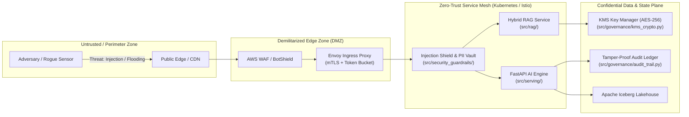

# Enterprise AI Threat Model: STRIDE & OWASP Top 10 for LLMs

**Standard Reference:** Microsoft STRIDE Methodology & OWASP Top 10 for Large Language Applications v2025  
**System Target:** Smart Manufacturing AI Platform, Telemetry Ingestion, Hybrid RAG Copilot, and Edge Ingestors  
**Security Tier:** Mission-Critical Industrial OT/IT Convergence  
**Status:** Validated & Enforced  

---

## 1. System Attack Surface & Architecture Boundaries

The platform operates at the critical intersection of operational technology (OT) sensors and cloud/enterprise AI serving infrastructure.



---

## 2. STRIDE Threat Analysis Matrix

| STRIDE Category | Threat Description & Attack Vector | Impacted Component | CVSS v3.1 | Codebase Defense & Mitigation Architecture |
|:---|:---|:---|:---|:---|
| **Spoofing (S)** | Adversary injects fabricated vibration metrics to simulate false alarms or conceal spindle bearing degradation. | `services/telemetry-gateway-go/`, Kafka Ingestion | **7.5 (High)** `CVSS:3.1/AV:N/AC:L/PR:N/UI:N/S:U/C:N/I:H/A:N` | Dual authentication via mTLS client certificates at edge gateway; cryptographic signature verification on sensor packets before topic publish. |
| **Tampering (T)** | Malicious insider modifies defect classification labels in historical dataset to degrade model retraining accuracy (Data Poisoning). | `src/data_platform/lakehouse.py`, Training Pipeline | **8.1 (High)** `CVSS:3.1/AV:N/AC:L/PR:L/UI:N/S:U/C:N/I:H/A:H` | Apache Iceberg immutable snapshots with cryptographic SHA-256 manifest validation; all table updates append-only with strict GitOps audit trails. |
| **Repudiation (R)** | Plant operator initiates an emergency machine halt, causing production loss, then denies issuing the command. | `src/patterns/saga_orchestrator.py`, Maintenance API | **6.5 (Med)** `CVSS:3.1/AV:N/AC:L/PR:L/UI:N/S:U/C:N/I:H/A:N` | Append-only SHA-256 hash-chained cryptographic ledger (`src/governance/audit_trail.py`). Every action records timestamp, operator ID, tenant ID, and parent block hash. |
| **Information Disclosure (I)** | Prompt injection attack prompts RAG copilot to exfiltrate proprietary machine operating limits and internal technician credentials. | `src/rag/rag_service.py`, `src/security_guardrails/pii_filter.py` | **8.6 (High)** `CVSS:3.1/AV:N/AC:L/PR:N/UI:N/S:U/C:H/I:N/A:N` | Multi-layer defense: In-line PII masking (`PIIFilterVault`), prompt injection heuristics (`InjectionDefenseEngine`), and post-generation SOP boundary regex filtering. |
| **Denial of Service (D)** | Attacker floods inference endpoints with high-token recursive prompts or concurrent large queries, starving real-time telemetry alerting. | `src/serving/app.py`, `src/governance/multi_tenant.py` | **7.5 (High)** `CVSS:3.1/AV:N/AC:L/PR:N/UI:N/S:U/C:N/I:N/A:H` | Token-bucket rate limiting (60 RPM) and daily token ceiling enforcement (`MultiTenantManager`); Envoy circuit-breaking on upstream latency > 200ms. |
| **Elevation of Privilege (E)** | Technician prompt convinces LLM copilot that user has executive authority, commanding automated bypass of physical safety valves. | `src/security_guardrails/guardrails.py`, Saga Actions | **9.8 (Critical)** `CVSS:3.1/AV:N/AC:L/PR:N/UI:N/S:U/C:H/I:H/A:H` | Hard safety guardrail rules (`SafetyGuardrails.validate_output`): strictly forbids bypassing safety interlocks, relief valves, or pressure limits regardless of context. |

---

## 3. OWASP Top 10 for LLMs Threat Deep Dive

### 3.1 LLM01: Prompt Injection
* **Threat Profile**: Indirect and direct prompt injections attempting to override system instructions via DAN (Do-Anything-Now) jailbreaks, markdown delimiter escapes (`---END OF SYSTEM---`), or base64-encoded payload attacks.
* **Mitigation Implementation**:
  * Evaluated in `src/security_guardrails/injection_defense.py`.
  * Multi-heuristic scoring: checks for override phrases (`ignore previous instructions`), delimiter exploits (````system`), and decoded base64 instruction strings.
  * Risk score $\ge 0.5$ triggers immediate rejection with HTTP 400 and security alert logging.

### 3.2 LLM02: Insecure Output Handling
* **Threat Profile**: LLM responses containing malicious JavaScript or shell command sequences forwarded to plant technician consoles or SCADA integration webhooks.
* **Mitigation Implementation**:
  * Output sanitization via `SafetyGuardrails.validate_output` in `src/security_guardrails/guardrails.py`.
  * Forbids execution directives like `eval()`, `os.system()`, or physical bypass commands.

### 3.3 LLM04: Model Denial of Service
* **Threat Profile**: Adversaries submit queries engineered to trigger maximal cross-attention computation or excessive vector search top-$k$ traversals.
* **Mitigation Implementation**:
  * Enforced in `src/governance/multi_tenant.py` and `src/rag/hybrid_retriever.py`.
  * Query string length capped at 1,024 characters; maximum retrieval limit $k \le 20$; daily token quotas per tenant with automatic quota rejection.

### 3.4 LLM06: Sensitive Information Disclosure
* **Threat Profile**: Extraction of operator PII (emails, phone numbers, tax IDs) or proprietary machine serial identifiers via RAG retrieval over uncurated technician shift notes.
* **Mitigation Implementation**:
  * `PIIFilterVault` (`src/security_guardrails/pii_filter.py`) automatically tokenizes sensitive patterns before text enters the retrieval pipeline or model inference context.
  * Reversible only by authorized callers using secure token mapping keys.

### 3.5 LLM08: Excessive Agency
* **Threat Profile**: Autonomous LLM agents executing real-world physical changes (e.g., shutting down a cooling pump) based on hallucinations without human verification.
* **Mitigation Implementation**:
  * Saga Orchestrator (`src/patterns/saga_orchestrator.py`) enforces strict Human-In-The-Loop (HITL) break-glass verification for irreversible mechanical actions.
  * All automated actions require compensatable workflows with explicit rollback procedures.

---

## 4. Threat Model Verification & Automated Test Evidence

Automated regression tests validate every threat vector continuously in CI:
* **Test Case**: `tests/test_enterprise_architect.py::test_prompt_injection_defense`
  * Validates detection of jailbreaks, base64 payloads, and delimiter spoofing.
* **Test Case**: `tests/test_enterprise_architect.py::test_safety_guardrails_mechanical_limits`
  * Validates rejection of requests bypassing safety relief valves.
* **Test Case**: `tests/test_enterprise_architect.py::test_audit_trail_tamper_detection`
  * Validates detection of tampering in historical ledger blocks.
* **Test Case**: `tests/test_enterprise_architect.py::test_tenant_rate_limits`
  * Validates DoS prevention via RPM and daily token quota enforcement.
