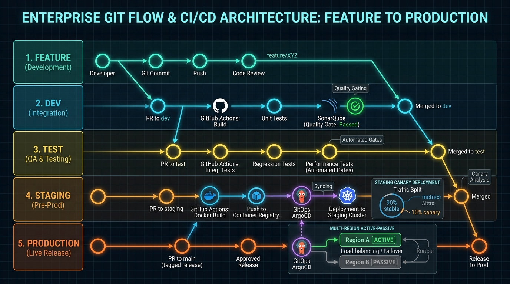
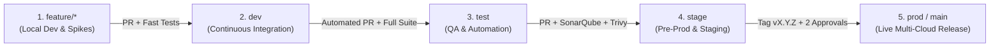

# Enterprise Git Branching & Promotion Strategy (5-Tier Industry Standard)

**Classification:** Enterprise Engineering Standard  
**Target Organization:** Smart Manufacturing AI & Multi-Cloud MLOps Platform  
**Author:** Principal AI Architect  
**Version:** 3.0.0  

---

## 1. Architectural Overview & Workflow Visualization

To ensure continuous delivery velocity without compromising safety on mission-critical industrial manufacturing assembly lines, the platform implements a **5-Tier Enterprise Git Branching Model** combining GitFlow rigor with Trunk-Based progressive delivery.





---

## 2. Granular Tier & Branch Specification

### Tier 1: `feature/*` (Feature Sandbox)
* **Purpose**: Isolated development of individual microservices, algorithms, or bug fixes.
* **Source Branch**: Branched off `dev`.
* **Merge Target**: Pull Request into `dev`.
* **Automated CI Gates**:
  * Ruff linter (`ruff check src/ tests/`).
  * MyPy static type analysis (`mypy src/`).
  * Lightweight unit test suite (`pytest tests/test_models.py tests/test_api.py`).
* **Environment**: Local workstation / Docker Compose (`./deploy.sh --compose`).

### Tier 2: `dev` (Continuous Integration)
* **Purpose**: Collective integration stream for all merged features.
* **Target Environment**: In-cluster Kubernetes Development Namespace (`smart-manufacturing-dev`).
* **Manifest Overlay**: `k8s/overlays/dev/`.
* **Automated Actions**:
  * Rebuilds and pushes Docker image `kishorkumarparoi/smart-manufacturing:dev-latest`.
  * Triggers GitOps ArgoCD automatic sync to local K3s / Dev Kubernetes cluster.
  * Fast feedback loop for developers (<3 minutes build-to-deploy).

### Tier 3: `test` (Automated QA & Resiliency Validation)
* **Purpose**: Dedicated environment for automated end-to-end integration tests, load profiling, and disaster recovery failover validation.
* **Target Environment**: Kubernetes Test Namespace (`smart-manufacturing-test`).
* **Manifest Overlay**: `k8s/overlays/test/`.
* **Automated Verification Gates**:
  * Full test suite execution with code coverage assertion ($\ge 80\%$ statement coverage).
  * Failover logic verification (`pytest tests/test_failover_logic.py`).
  * Distributed pattern tests (`pytest tests/test_enterprise_architect.py`).
  * 15-minute simulated sensor spike (10,000 QPS) via Locust / k6.

### Tier 4: `stage` (Pre-Production Staging)
* **Purpose**: Final pre-flight rehearsal environment mirroring production network, IAM policies, and cloud infrastructure.
* **Target Environment**: GKE / EKS Staging Cluster (`smart-manufacturing-stage`).
* **Manifest Overlay**: `k8s/overlays/stage/`.
* **Automated Quality Gates**:
  * **SonarQube Quality Gate**: Zero blocker/critical bugs, code duplication $<3\%$, security rating 'A'.
  * **Trivy Container CVE Scan**: Zero `CRITICAL` or `HIGH` vulnerabilities.
  * **Canary Progressive Rollout**: 10% traffic routing for 15 minutes with automated Prometheus metric analysis.

### Tier 5: `prod` (and `main` / `production`) (Live Production Release)
* **Purpose**: Customer-facing, high-availability multi-cloud production environment.
* **Target Clusters**:
  * **Primary Active**: AWS EKS `us-east-1` (ALB Ingress, GPU worker pool).
  * **Standby Passive**: GCP GKE `us-central1` (Warm standby, automated failover prober).
* **Manifest Overlay**: `k8s/overlays/prod/` and `k8s/overlays/production/`.
* **Release Protocol**:
  * Requires Semantic Versioning Git Tag (`git tag -a v1.5.0 -m "Release v1.5.0"`).
  * Mandatory 2 Senior Peer Approvals on GitHub Pull Request.
  * Automated ArgoCD GitOps sync with zero-downtime rolling updates.

---

## 3. Multi-Branch Promotion & Governance Matrix

| Branch | Target Environment | Kubernetes Overlay | Automated CI Checks | Approval Mandate | Promotion Trigger |
|:---|:---|:---|:---|:---|:---|
| **`feature/*`** | Local / Docker Compose | N/A (Docker Compose) | Ruff, MyPy, Fast Unit Tests | Self / Pair Engineer | Developer PR to `dev` |
| **`dev`** | K8s Dev Namespace | `k8s/overlays/dev/` | Full Unit Tests, Container Build | 1 Peer Approval | Automated push to `dev` |
| **`test`** | K8s Test Namespace | `k8s/overlays/test/` | Full Integration Suite, Failover Probes | QA / Automation Lead | PR merge from `dev` |
| **`stage`** | Pre-Prod Staging Cluster | `k8s/overlays/stage/` | SonarQube Gate, Trivy CVE Scan, Canary | Lead Engineer / Architect | PR merge from `test` |
| **`prod`** | Multi-Cloud Production | `k8s/overlays/prod/` | Progressive Rollout Analysis, Health Audit | 2 Senior Approvals + Architect | Tagged Release (`vX.Y.Z`) |

---

## 4. Developer Step-by-Step Command Playbook

### Step 1: Create a Feature Branch
```bash
# Ensure dev is clean and updated
git checkout dev
git pull origin dev

# Create feature branch with semantic prefix
git checkout -b feature/spindle-vibration-enhancement
```

### Step 2: Develop, Test, and Commit Locally
```bash
# Run local fast test suite
pytest tests/test_models.py tests/test_api.py -v

# Commit with Conventional Commits convention
git commit -m "feat(models): implement SIMD vibration spectral filtering"
git push -u origin feature/spindle-vibration-enhancement
```

### Step 3: Promote Feature to `dev`
```bash
# Open PR from feature -> dev on GitHub
# Once merged, sync local dev
git checkout dev
git pull origin dev
```

### Step 4: Promote `dev` to `test`
```bash
git checkout test
git pull origin test
git merge dev --no-ff -m "merge: promote dev sprint 23 to test"
git push origin test
```

### Step 5: Promote `test` to `stage`
```bash
git checkout stage
git pull origin stage
git merge test --no-ff -m "release-candidate: promote test to stage for pre-flight scan"
git push origin stage
```

### Step 6: Tag and Promote to `prod`
```bash
git checkout prod
git pull origin prod
git merge stage --no-ff -m "release: promote stage to prod (v2.1.0)"

# Create immutable cryptographic release tag
git tag -a v2.1.0 -m "Production Release v2.1.0: Enterprise RAG + Saga Engine"
git push origin prod --tags
```
