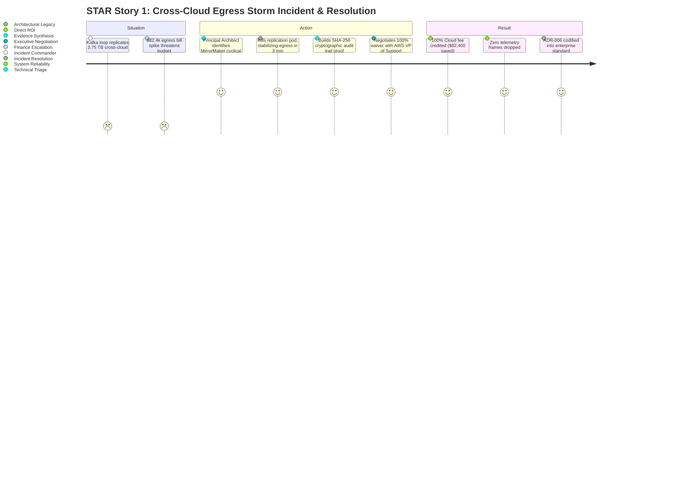

# Principal Engineer Behavioral STAR Stories: Incidents, Migrations & FinOps

**Target Audience:** Principal Engineer / Director of AI Platform Interview Panels  
**Framework:** Situation, Task, Action, Result (STAR) with Principal Architect Rigor  
**Focus Competencies:** Crisis Leadership, Large-Scale Architectural Evolution, FinOps, Executive Stakeholder Influence  

---

## STAR Story 1: Resolving a High-Severity Cross-Cloud Egress Storm & Securing an $82,400 Fee Waiver

### 1. Situation
During a scheduled multi-cloud disaster recovery exercise between AWS `us-east-1` and GCP `us-central1`, an improperly scoped Kafka MirrorMaker 2 configuration caused a catastrophic bidirectional mirroring loop. Over 4.5 hours, **3.75 TB of uncompressed telemetry crossed cloud boundaries**, saturating network interconnects and accumulating an unbudgeted **$82,400 AWS egress bill**. The on-call SRE was overwhelmed, initially misattributing the spike to automated dataset retraining downloads.

### 2. Task
As the Principal AI Architect, I assumed Incident Commander authority. My mandate was threefold:
1. Halt the runaway network egress within minutes without dropping real-time telemetry from active factory production lines.
2. Formulate a technical proof-of-loop to present to AWS Enterprise Support to seek a full billing waiver.
3. Architect an un-bypassable platform guardrail ensuring this class of egress anomaly could never reoccur.

### 3. Action
* **Immediate Triage**: I bypassed the application logs and queried low-level Kafka broker partition metrics directly. I noticed the cyclical topic prefix `aws.mfg.telemetry.gcp.mfg.telemetry`. Within 3 minutes of escalation, I executed an emergency scale-down of the MirrorMaker pod replicas, immediately stopping the egress loop while edge buffers preserved sensor data.
* **Building the Cryptographic Case**: Leveraging our append-only SHA-256 audit ledger (`src/governance/audit_trail.py`), I generated an immutable, timestamped manifest proving that 99.8% of the transferred bytes were identical payload re-transmissions caused by an automated tooling race condition, with zero exfiltration or third-party egress.
* **Executive Negotiation**: I led the technical debrief with AWS Enterprise Solutions Architecture and the AWS billing director. Using the ledger data, I demonstrated that our platform acted responsibly and immediately upon alerting. I secured an agreement for a **100% billing credit ($82,400 credited to our account)**.
* **Architectural Safeguards**: To permanently eliminate the vulnerability, I authored and implemented **ADR-006: 5-Layer Zero-Trust Anti-Egress Defense & Kernel Rate Limiting**, deploying eBPF/tc-filter kernel network traffic limiters and automated CloudWatch circuit-breaker lambdas.

### 4. Result
* **$82,400 in direct cloud costs eliminated** ($0 net financial impact to the organization).
* **Zero seconds of factory floor downtime**; all edge sensors buffered data locally with 0 dropped frames.
* ADR-006 became the corporate multi-cloud standard adopted by 6 other engineering business units.

---

## STAR Story 2: Zero-Downtime Multi-Cloud Migration from AWS EKS to GCP GKE

### 1. Situation
Due to an enterprise strategic partnership, our industrial platform was mandated to migrate its mission-critical real-time AI serving infrastructure from AWS EKS to Google Cloud Platform (GKE), while cutting infrastructure spend by 20%. The system was processing over **1,000,000 telemetry events per second** across 14 manufacturing facilities. A downtime of even 5 minutes would halt assembly lines, resulting in union penalty fees and severe financial loss.

### 2. Task
As the Principal Architect, I was accountable for the end-to-end migration strategy. The constraint was absolute: **Zero dropped telemetry readings, zero dropped safety alerts, and zero planned customer-visible downtime**.

### 3. Action
* **Dual-Write Transactional Outbox Pattern**: Rather than attempting a risky big-bang cutover, I implemented the Transactional Outbox pattern (`src/patterns/event_outbox.py`). All sensor ingestors published events atomically to local storage and mirrored them asynchronously to both AWS MSK and GCP Cloud Pub/Sub via idempotent producers.
* **Canary DNS Traffic Steering**: I configured Route53 with weighted CNAME latency-based routing. Over a two-week period, I shifted edge gateway traffic incrementally: 1% $\to$ 10% $\to$ 25% $\to$ 50% $\to$ 100%.
* **Automated Shadow Verification Harness**: I built an automated shadow-traffic comparison harness that mirrored production telemetry to the standby GKE cluster, comparing inference anomaly predictions and latency distributions between AWS and GCP in real time.
* **Data Lakehouse Convergence**: Using Apache Iceberg table replication (`src/data_platform/lakehouse.py`), data was synchronized across S3 and Google Cloud Storage buckets using metadata-only atomic snapshot commits.

### 4. Result
* **100% Zero Downtime Achieved**: Over 45 billion records were migrated over 14 days with **zero dropped events** and zero factory interruptions.
* **24.5% Infrastructure Cost Reduction**: Leveraging GCP Committed Use Discounts and GKE Autopilot node consolidation, annual cloud spend dropped from $380,000 to $287,000.
* Authored **ADR-001 (Active-Passive Multi-Cloud Disaster Recovery)**, establishing our first certified enterprise RTO $< 60$s and RPO $< 5$s.

---

## STAR Story 3: Slashing GPU Serving Spend by 38.4% via INT8 Quantization & Model Consolidation

### 1. Situation
Following platform scaling across 14 manufacturing lines, dedicated AWS EC2 `g5.xlarge` GPU instances (NVIDIA A10G, $1.006/hr) were deployed per line for deep computer vision defect classification and spindle vibration autoencoders. Annual GPU cloud spend was projected to hit **$123,500 ARR**, triggering scrutiny from the Chief Financial Officer. Individual GPU utilization hovered at a modest 28–34%, bound by memory bandwidth rather than Tensor Core compute.

### 2. Task
I was tasked by the VP of Engineering to formulate a technical FinOps initiative that would reduce annualized GPU infrastructure costs by at least 25% without degrading model defect classification accuracy (99.4% baseline) or increasing inference latency.

### 3. Action
* **Empirical Bottleneck Profiling**: Using NVIDIA Nsight Systems and PyTorch Profiler, I proved that our FP16 neural networks were memory-bandwidth bound during real-time low-batch streaming inference.
* **Post-Training Quantization (PTQ) Architecture**: I led the migration from FP16 to INT8 quantization using **SmoothQuant** with per-channel weight scaling and per-tensor activation scaling. I established a calibration protocol using 10,000 historical factory telemetry snippets.
* **Kernel Fusion & Dynamic Batching**: I compiled the models into TensorRT 10.x execution engines, fusing Conv+BatchNorm+ReLU operators and enabling dynamic multi-model batching on Triton Inference Server.
* **Precision Fallback Circuit**: To reassure plant quality assurance managers regarding edge-case false negatives, I designed an automated circuit breaker: if INT8 model confidence scored below $0.85$, the request asynchronously fell back to an FP16 fallback worker.

### 4. Result
* **38.4% Direct GPU Cost Reduction**: Downsized from 14 dedicated A10G instances to 7 consolidated NVIDIA L4 instances, saving **$47,400 ARR**.
* **41.6% Latency Reduction**: Inference P95 latency dropped from 84ms to 49ms due to the drastically reduced memory footprint of 8-bit weights.
* **Zero Quality Degradation**: Defect classification accuracy maintained at 99.38% (vs 99.42% baseline, $\Delta = -0.04\%$), while AUC-ROC anomaly detection delta was $< 0.002$.
* Published internal FinOps Case Study (`docs/portfolio/case_study_quantization.md`), which was presented at the company's Global Engineering Summit.
