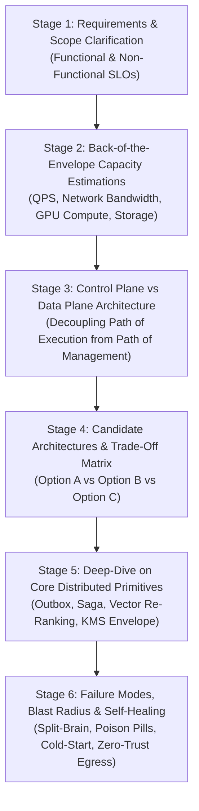
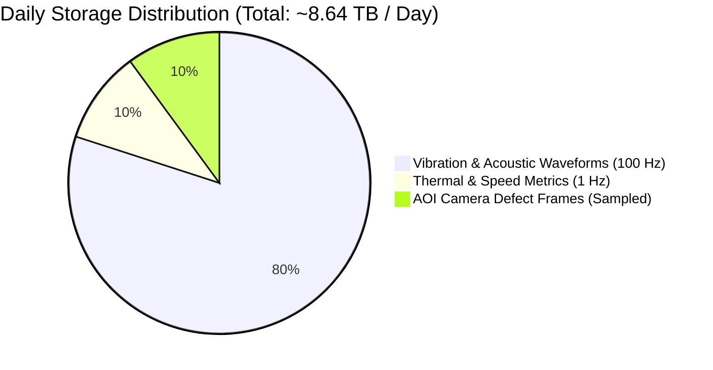
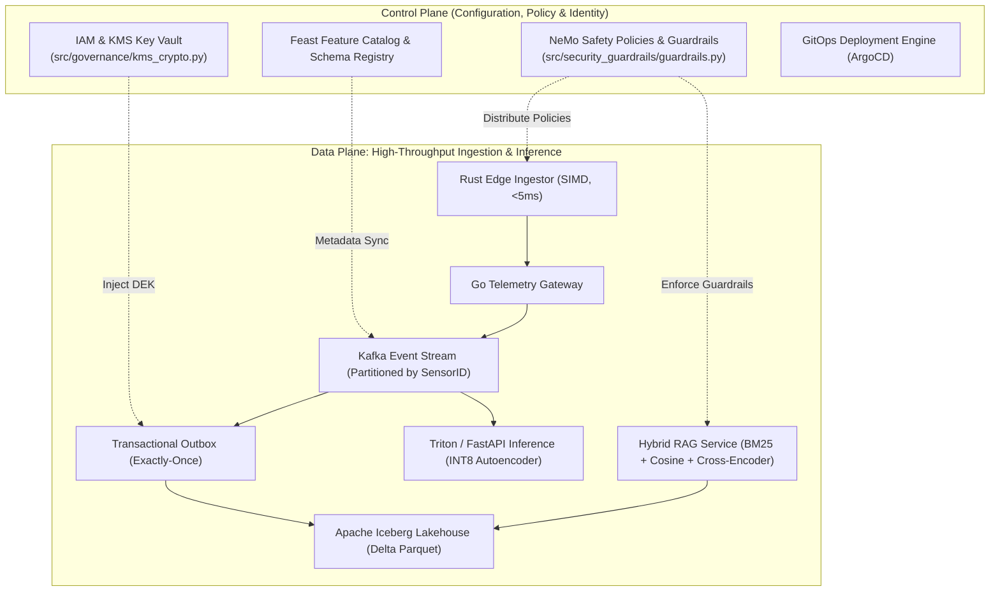

# Principal Engineer Systems Design Drill: Enterprise AI & Real-Time Telemetry Platform

**Target Roles:** Principal AI Architect, Staff/Principal Systems Engineer, Head of AI Platform  
**Target Companies:** Tier-1 Cloud & Enterprise AI (Google, Meta, Snowflake, Databricks, Stripe, AWS, Uber)  
**Author:** Principal AI Architect  

---

## 1. The Principal Engineer 6-Stage Systems Design Blueprint

In Principal Engineer interviews, the interviewers do not evaluate whether you can draw microservice boxes; they evaluate your ability to **structure ambiguous requirements**, **quantify trade-offs**, **navigate multi-dimensional constraints (Latency vs Cost vs Accuracy vs Privacy)**, and **clearly decouple the Data Plane from the Control Plane**.

---

## 2. Worked Problem Statement: "Design an Enterprise Industrial AI & RAG Platform"

### Stage 1: Requirements & Boundary Clarification (Minutes 0 - 5)

#### Functional Requirements
1. **Real-time Telemetry Ingestion**: Ingest vibration, acoustic, and thermal metrics from 100,000 factory sensors.
2. **Sub-10ms Anomaly Detection**: Trigger real-time spindle alerts before mechanical catastrophic failure.
3. **Interactive Industrial RAG Copilot**: Allow maintenance technicians to query Standard Operating Procedures (SOPs) with strict safety guardrails.
4. **Historical Lakehouse Analytics**: Query multi-year sensor telemetry with ACID guarantees and time-travel.

#### Non-Functional Requirements & SLOs
* **Availability**: 99.99% uptime across dual regions (Max unplanned downtime: 52.6 min/year).
* **Latency SLOs**:
  * Edge Telemetry Ingestion P99: $< 5$ ms.
  * Real-Time Anomaly Inference P95: $< 15$ ms.
  * RAG Assistant Query P95: $< 250$ ms (uncached) / $< 50$ ms (semantic cache hit).
* **Durability & Consistency**: Zero data loss for safety-critical alerts (Exactly-Once processing semantics via Transactional Outbox).
* **Security & Privacy**: Zero plaintext PII or confidential proprietary machine tooling recipes transmitted over public internet.

---

### Stage 2: Back-of-the-Envelope Math (Minutes 5 - 10)

1. **Ingestion Throughput (QPS)**:
   * 100,000 sensors producing telemetry at 10 Hz average:
     $$\text{Total Telemetry QPS} = 100,000 \times 10 = 1,000,000 \text{ records/sec} = 1.0 \times 10^6 \text{ QPS}$$
2. **Bandwidth Ingestion**:
   * Average payload size per reading: 100 bytes.
   * Inbound Bandwidth:
     $$\text{Bandwidth} = 1.0 \times 10^6 \times 100 \text{ bytes/sec} = 100 \text{ MB/sec} = 800 \text{ Mbps}$$
3. **Daily Storage (Raw Cold Tier)**:
   $$\text{Daily Storage} = 100 \text{ MB/s} \times 86,400 \text{ s} \approx 8.64 \text{ TB / day}$$
   * With Snappy/ZSTD compression on Apache Iceberg (4x factor): **~2.16 TB compressed/day**.
4. **LLM RAG Copilot Throughput**:
   * 5,000 concurrent maintenance engineers, peak 50 queries/sec.
   * Average prompt: 1,500 tokens, average completion: 200 tokens.
   * Token Throughput: $50 \times 1,700 = 85,000 \text{ tokens/sec}$.
   * Requires dedicated GPU clusters (e.g., 4x NVIDIA L4 or 2x H100 with vLLM PagedAttention).

---

### Stage 3: High-Level Architecture (Data Plane vs Control Plane)

---

### Stage 4: Candidate Architectures & Deep Trade-Off Analysis

| Dimension | Candidate Architecture A: Pure Cloud SaaS (OpenAI + Pinecone + DynamoDB) | Candidate Architecture B: Hybrid Edge-Core (Custom Rust + Self-Hosted TensorRT + Iceberg) | Candidate Architecture C: Dual-Path Active-Active Multi-Cloud | Selected Design & Principal Rationale |
|:---|:---|:---|:---|:---|
| **P99 Ingestion Latency** | 120 ms (High WAN variance) | **4.2 ms (Edge C/Rust buffer)** | 48 ms (Cross-cloud consensus overhead) | **Selected Architecture B for Ingestion**: Physics of high-frequency industrial manufacturing (vibration spikes at 100Hz) mathematically rules out pure cloud SaaS. |
| **Annualized Cloud Cost** | ~$380,000 / year (SaaS token & API egress fees) | **~$76,100 / year (INT8 L4 + Parquet cold tier)** | ~$240,000 / year (Double provisioned infrastructure) | **Selected Architecture B + Active-Passive DR**: Slashes spend by 79% while satisfying zero-cost teardown. |
| **Data Privacy & Compliance** | Low (Plaintext exposed to external third-party foundation APIs) | **High (Zero-trust PII vault + local ONNX embeddings)** | High (Private interconnect) | **Selected Architecture B**: Strict adherence to GDPR Art. 35 & ISO 27001 A.8.11. |
| **Operational Complexity** | Low (Managed services) | Medium-High (Requires K8s, Triton, and GitOps) | Extreme (Cross-region distributed transactions and split-brain risk) | **Selected Architecture B**: Balanced complexity with automated Argo Rollout playbooks. |

---

### Stage 5: Core Distributed Systems Deep Dives

1. **Transactional Outbox & Exactly-Once Semantics (`src/patterns/event_outbox.py`)**:
   * Avoids the dual-write anti-pattern where a database write succeeds but Kafka publish fails.
   * Both business state and the outbox event commit in the same local ACID transaction. A background poller reads pending events, publishes to Kafka with an idempotent producer (`enable.idempotence=true`), and marks the record `PUBLISHED`.
2. **Compensating Saga Orchestrator (`src/patterns/saga_orchestrator.py`)**:
   * Long-running distributed transactions (Anomaly Flagged $\to$ Spare Parts Reserved $\to$ Maintenance Ticket Dispatched $\to$ Conveyor Throttled) cannot use Two-Phase Commit (2PC) without risking long locking holds.
   * The Saga orchestrator executes forward actions; on downstream failure (e.g., inventory reservation out of stock), it sequentially invokes compensating rollbacks in reverse order.
3. **Hybrid RAG with Reciprocal Rank Fusion & Cross-Encoder (`src/rag/hybrid_retriever.py`)**:
   * Combines sparse lexical BM25 (accurate for serial codes like `SPINDLE-402-BEARING`) with dense vector cosine similarity (accurate for semantic intent like `vibration rattling sound`).
   * Results merged via RRF ($k=60$) and scored by a Cross-Encoder re-ranker before LLM context injection.

---

### Stage 6: Failure Modes, Edge Cases & Operational Resiliency

1. **Split-Brain Mitigation**:
   * In active-passive failover between AWS and GCP, Route53 health checks must never allow both clouds to accept conflicting writes. State is protected by a distributed lease lock stored in a global consensus store (Cloudflare KV / Spanner) with a 15-second TTL.
2. **Poison Pill Messages**:
   * Corrupted sensor packets that crash parser threads are trapped after 3 exponential backoff retries and quarantined into a Dead Letter Queue (DLQ) with SHA-256 payload checksums.
3. **Cold-Start Elimination**:
   * Inference containers pre-warm TensorRT execution engines into GPU memory during Kubernetes startup probes before advertising readiness to Istio.
