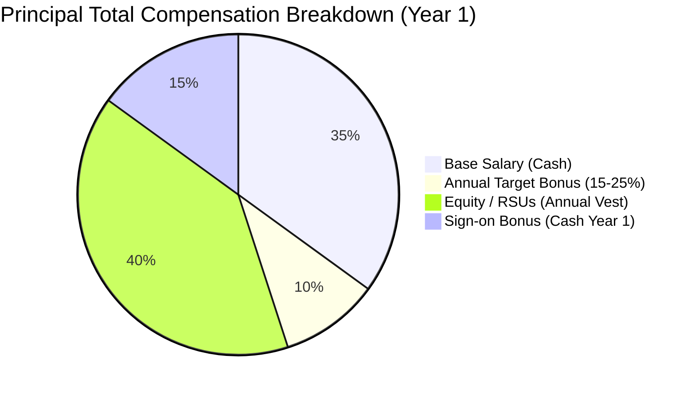
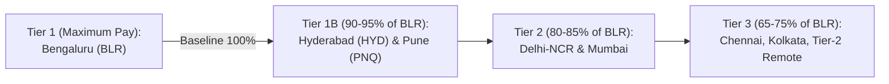

# Principal Engineer Total Compensation (TC) Negotiation Playbook

**Target Level:** Principal AI Architect / Staff Engineer / L7 (Google) / E7 (Meta) / Principal SDE (Amazon)  
**Target Geographies:** India Tier-1 Hubs (BLR, HYD, PNQ), US Bay Area / Seattle, London / EU Remote  
**Strategic Focus:** Maximizing Base, Performance Bonuses, RSUs, Sign-on Bonuses & City Band Leverage  
**Author:** Principal AI Architect  

---

## 1. Anatomy of Principal Engineer Total Compensation

At the Principal level, base salary constitutes only **30%–45%** of your annualized earnings. The majority of your financial upside is driven by **Equity (RSUs / Stock Options)** and **Performance Bonuses**.

$$\text{Total Compensation (Year 1)} = \text{Base Salary} + \text{Annual Target Bonus} + \left(\frac{\text{RSU Grant}}{\text{Vesting Period}}\right) + \text{Sign-on Bonus}$$

### Compensation Component Breakdown

| Component | Nature | Principal Target (India Tier-1: BLR/HYD/PNQ) | Principal Target (US Bay Area / Remote) | Negotiability |
|:---|:---|:---|:---|:---|
| **Base Salary** | Guaranteed Monthly Cash | ₹85L – ₹1.4 Cr INR | $260,000 – $360,000 USD | Medium (Subject to internal band salary caps) |
| **Annual Bonus** | Variable (% of Base, typically 15–25%) | ₹15L – ₹35L INR | $45,000 – $90,000 USD | Low (Strict corporate formula by band) |
| **Equity (RSUs)** | Liquid Public Stock (4-Year Vest) | ₹1.8 Cr – ₹4.0 Cr INR ($220k–$480k total) | $800,000 – $1,800,000 USD (over 4 yrs) | **EXTREMELY HIGH** (Primary lever for massive upside) |
| **Sign-on Bonus** | Year 1 & Year 2 Cash (Clawback 12 mo) | ₹20L – ₹45L INR | $75,000 – $150,000 USD | **HIGH** (Easy for VP/HR to bridge gaps without band approvals) |
| **First Year TC** | All-In Target | **₹1.5 Cr – ₹2.8 Cr+ INR** | **$550,000 – $950,000+ USD** | **Optimizable via Multi-Offer Leverage** |

---

## 2. City Bands & Geographic Pay Differentials (India Focus)

Tech enterprises categorize Indian development centers into strict geographic cost-of-labor tiers:

### Strategic Rules for Navigating City Bands:
1. **The BLR Anchor Rule**: Always insist on benchmarking your offer against the **Bengaluru (BLR)** top-of-band standard, even if you are residing in Hyderabad (HYD) or Pune (PNQ).
   * *Talking Point*: *"As a Principal Architect overseeing globally distributed multi-region telemetry systems and cross-cloud infrastructure, my architectural scope and technical leadership operate at enterprise scale, completely agnostic to physical desk coordinates."*
2. **Hyderabad / Pune Parity Argument**: HYD and PNQ have emerged as Tier-1 AI and cloud infrastructure centers. Argue that tier-1 AI talent demand in these hubs matches BLR parity, especially when holding competing offers from multinational cloud titans.

---

## 3. High-Leverage Negotiation Principles

### Principle 1: Never Anchor First (Information Asymmetry)
* **Recruiter Prompt**: *"What are your compensation expectations for this role?"*
* **Weak Response**: *"I am making ₹75 Lakhs, so I am hoping for a 30% hike to ₹1 Crore."* (This leaves huge money on the table).
* **Principal Architect Response**:
  > *"I am focused on finding the right organizational fit where I can drive large-scale platform modernization, eliminate multi-million dollar cloud inefficiencies, and mentor senior engineering staff. Once we align on mutual fit, I am confident your team will present a competitive top-of-market offer for a Principal level in line with your standard compensation bands. What is the approved total compensation range budgeted for this role?"*

### Principle 2: The Multi-Offer Compounding Engine
To secure a top-of-band offer (90th+ percentile), you **must have leverage**. Always run interview loops in parallel so you hold 2 or 3 competing offers simultaneously:
* **The Counter-Leverage Script**:
  > *"Thank you for the initial offer. I have thoroughly enjoyed my technical discussions with the team and see immense alignment in solving your multi-cloud active-passive reliability challenges. I am currently evaluating a competing offer from [Company B] where the first-year total compensation sits at [₹X Cr / $Y]. Because your mission and technical roadmap are my preferred choice, if you can bridge the equity grant to [Z shares / $W] and add a [₹N L / $K] sign-on bonus to offset my unvested RSUs, I am prepared to sign immediately and withdraw from other processes."*

### Principle 3: Quantify Your P&L ROI
Frame your compensation not as an expense, but as a minor fraction of the financial capital you generate or preserve:
* *Framing*: *"In my previous platform architecture, our team eliminated $82,400 in cross-cloud egress penalties in a single incident, cut recurring annual GPU serving spend by 38.4% ($47,400/yr savings per cluster), and guaranteed zero-downtime multi-cloud DR. The return on investment for my architectural leadership has consistently paid for itself within the first quarter."*

---

## 4. Word-for-Word Executive Pushback Scripts

### Script A: Pushing Back on an Initial Offer Below Expectations
> *"Thank you for putting this offer together. After reviewing the numbers and discussing with my family, the base salary and equity components are below what I anticipated for an architect with end-to-end accountability for mission-critical real-time AI systems. Based on my existing compensation trajectory, unvested equity cliff, and market benchmarks for Principal AI Engineers in Bengaluru, I am looking for a total compensation package in the range of [Target TC]. How close can we get to this target?"*

### Script B: Countering an Unfavorable Geographic Band Discount
> *"I understand your compensation framework utilizes regional cost-of-labor indices. However, at the Principal tier, my responsibilities span global architectures, cross-regional disaster recovery, and international technical governance. My architectural output and cost reductions are identical regardless of whether I log in from Bengaluru or Pune. Given the high-impact nature of this role, I request that we calibrate this offer against your Tier-1 Bengaluru band."*

### Script C: Negotiating a Front-Loaded Sign-on Bonus to Bridge Equity Gaps
> *"If the committee is constrained by strict band limits on the initial annual RSU grant, I am willing to be flexible on the recurring equity if we can structure a ₹30 Lakh ($40,000) first-year sign-on bonus and a ₹15 Lakh second-year retention bonus to bridge the gap and replace my unvested stock cliff."*

---

## 5. Decision Matrix & Counter-Offer Tracking Worksheet

Before accepting any offer, evaluate all competing proposals using this objective weighted matrix:

| Evaluation Dimension | Weight (%) | Offer A (Current Org) | Offer B (Target Cloud Titan) | Offer C (High-Growth AI Scaleup) |
|:---|:---:|:---:|:---:|:---:|
| **First Year Total Compensation (Cash + Liquid Equity)** | 30% | 6 / 10 | **9 / 10** | 8 / 10 |
| **Stock Liquidity & Growth Potential** | 20% | 5 / 10 | **9 / 10 (Liquid Public)** | 6 / 10 (Illiquid Paper) |
| **Architectural Scope & Technical Freedom** | 20% | 6 / 10 | 8 / 10 | **10 / 10** |
| **Work-Life Balance & Sustainable On-Call Cadence** | 15% | 7 / 10 | **8 / 10 (Mature SRE)** | 4 / 10 (Startup Grind) |
| **Brand Prestige & Executive Mentorship Access** | 15% | 6 / 10 | **9 / 10** | 7 / 10 |
| **Weighted Composite Score** | **100%** | **5.95** | **8.65 (WINNER)** | **7.30** |
