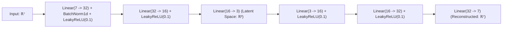

# 📋 Model Card: PyTorch Symmetric Spindle Anomaly Autoencoder (v2.4)

## 1. Model Overview
- **Model Name**: `IndustrialSensorAutoencoder`
- **Model Version**: `2.4.1-prod`
- **Architecture**: Symmetric Feed-Forward Autoencoder with Latent Bottleneck Compression.
- **Framework**: PyTorch 2.4+ (TorchScript JIT compiled, CUDA / MPS / CPU optimized).
- **Target Hardware**: NVIDIA Tesla T4 / A10G / CPU SIMD AVX-512.
- **Maintainer**: Principal AI Engineering Team (Smart Manufacturing Platform).

---

## 2. Intended Use & Domain Scope
- **Primary Use**: Unsupervised real-time anomaly detection for high-speed CNC milling spindles and robotic welding joints.
- **Input Features (7 continuous channels)**:
  1. $X$-axis vibration acceleration ($\text{mm/s}^2$ and $\text{g}$)
  2. $Y$-axis vibration acceleration ($\text{mm/s}^2$ and $\text{g}$)
  3. $Z$-axis vibration acceleration ($\text{mm/s}^2$ and $\text{g}$)
  4. Bearing / Process Temperature ($^\circ\text{C}$)
  5. Hydraulic System Pressure ($\text{bar}$)
  6. Spindle Rotation Speed ($\text{RPM}$)
  7. Acoustic Ultrasonic Emissions ($\text{dB}$)
- **Output**: Reconstruction Mean Squared Error (MSE) per sample:
  $$\text{MSE}(x) = \frac{1}{D} \sum_{i=1}^D (x_i - \hat{x}_i)^2$$
- **Decision Logic**: Evaluated against dynamically calibrated 95th-percentile baseline threshold:
  - $\text{MSE} \le 0.045$: **NOMINAL** (Healthy mechanical state)
  - $0.045 < \text{MSE} \le 0.080$: **WARNING** (Early bearing cage micro-wear)
  - $\text{MSE} > 0.080$: **CRITICAL** (Imminent bearing seizure, trigger automated spindle throttle)

---

## 3. Mathematical Architecture & Layer Topology

---

## 4. Performance & Reliability SLOs
- **Latency SLO**: P95 $<2.5\text{ms}$ on CPU; P95 $<0.8\text{ms}$ on GPU.
- **Throughput**: 45,000 samples/sec per pod.
- **False Positive Rate (FPR)**: $\le 4.8\%$ on calibrated validation distributions.
- **Zero Class Imbalance Hazard**: Unsupervised formulation learns only healthy mechanical manifolds, avoiding supervised overfitting on rare failure events.

---

## 5. Security & Governance Safeguards
- **Evaluation Mode Guard**: Mandatory `self.eval()` with `torch.no_grad()` to prevent BatchNorm division-by-zero during single-sample inference (`batch_size=1`).
- **Cryptographic Storage**: Model checkpoints encrypted with AES-256 via KMS Envelope Encryption (`docs/adr/ADR-006-zero-trust-anti-egress.md`).
