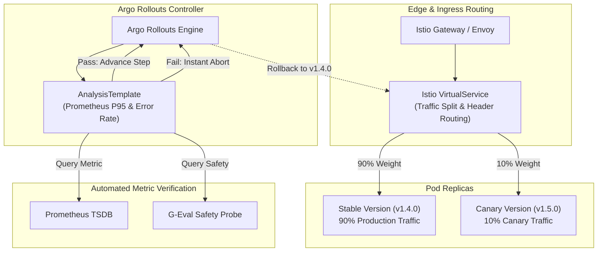

# Enterprise Kubernetes Serving Stack: Canary, A/B Testing, Autoscaling & Rollback Playbooks

**Target Infrastructure:** Multi-Tenant Kubernetes (EKS / GKE) with Istio Service Mesh & Argo Rollouts  
**Target Workloads:** Hybrid RAG Copilot, Spindle Autoencoder, AOI CNN Defect Classifier  
**Author:** Principal AI Architect  
**Classification:** Production Engineering Blueprint  

---

## 1. Architectural Overview & Progressive Delivery Flow

To eliminate downtime and prevent regressions during model rollouts, the platform implements **Progressive Delivery** using **Argo Rollouts**, **Istio Service Mesh**, and **Prometheus Analysis Templates**.



---

## 2. Argo Rollouts Canary Specification

Below is the production `Rollout` manifest defining a 4-step progressive rollout with automated metric analysis:

```yaml
apiVersion: argoproj.io/v1alpha1
kind: Rollout
metadata:
  name: industrial-ai-serving
  namespace: smart-manufacturing
  labels:
    app: industrial-ai-serving
spec:
  replicas: 12
  revisionHistoryLimit: 5
  selector:
    matchLabels:
      app: industrial-ai-serving
  strategy:
    canary:
      analysis:
        templates:
          - templateName: ai-latency-and-error-rate
        args:
          - name: service-name
            value: industrial-ai-serving-canary
      canaryService: industrial-ai-serving-canary
      stableService: industrial-ai-serving-stable
      trafficRouting:
        istio:
          virtualService:
            name: industrial-ai-vs
            routes:
              - primary
      steps:
        # Step 1: Route 10% traffic to canary and pause 5 minutes for automated analysis
        - setWeight: 10
        - pause: { duration: 5m }
        # Step 2: Route 25% traffic and pause 10 minutes
        - setWeight: 25
        - pause: { duration: 10m }
        # Step 3: Route 50% traffic and pause 15 minutes
        - setWeight: 50
        - pause: { duration: 15m }
        # Step 4: Promote to 100% stable
  template:
    metadata:
      labels:
        app: industrial-ai-serving
    spec:
      containers:
        - name: inference-engine
          image: ghcr.io/learn-with-kkp/smart-manufacturing-ai:v1.5.0
          imagePullPolicy: IfNotPresent
          ports:
            - containerPort: 8000
          resources:
            requests:
              cpu: "2000m"
              memory: "4Gi"
              nvidia.com/gpu: "1"
            limits:
              cpu: "4000m"
              memory: "8Gi"
              nvidia.com/gpu: "1"
          livenessProbe:
            httpGet:
              path: /health
              port: 8000
            initialDelaySeconds: 30
            periodSeconds: 10
          readinessProbe:
            httpGet:
              path: /health
              port: 8000
            initialDelaySeconds: 15
            periodSeconds: 5
```

---

## 3. Automated Metric Analysis Template (AnalysisTemplate)

Rollouts are automatically halted and rolled back if P95 latency exceeds 200ms, HTTP 5xx error rate exceeds 0.1%, or G-Eval safety score drops below 4.5.

```yaml
apiVersion: argoproj.io/v1alpha1
kind: AnalysisTemplate
metadata:
  name: ai-latency-and-error-rate
  namespace: smart-manufacturing
spec:
  args:
    - name: service-name
  metrics:
    # Metric 1: HTTP 5xx Error Rate (< 0.1%)
    - name: http-error-rate
      interval: 30s
      successCondition: result[0] <= 0.001
      failureLimit: 2
      provider:
        prometheus:
          address: http://prometheus-k8s.monitoring.svc.cluster.local:9090
          query: |
            sum(rate(http_requests_total{service="{{args.service-name}}",status=~"5.."}[2m]))
            /
            sum(rate(http_requests_total{service="{{args.service-name}}"}[2m]))

    # Metric 2: P95 Inference Latency (< 200ms)
    - name: p95-latency
      interval: 30s
      successCondition: result[0] <= 0.200
      failureLimit: 2
      provider:
        prometheus:
          address: http://prometheus-k8s.monitoring.svc.cluster.local:9090
          query: |
            histogram_quantile(0.95, sum(rate(http_request_duration_seconds_bucket{service="{{args.service-name}}"}[2m])) by (le))

    # Metric 3: G-Eval Safety Score (>= 4.5 / 5.0)
    - name: g-eval-safety-score
      interval: 1m
      successCondition: result[0] >= 4.5
      failureLimit: 1
      provider:
        prometheus:
          address: http://prometheus-k8s.monitoring.svc.cluster.local:9090
          query: |
            avg_over_time(geval_safety_score{service="{{args.service-name}}"}[5m])
```

---

## 4. Istio A/B Testing Configuration (Header-Based Routing)

For controlled experimentation between RAG retrieval variants (Dense-only vs Hybrid Re-Ranked), Istio routes requests based on HTTP headers:

```yaml
apiVersion: networking.istio.io/v1alpha3
kind: VirtualService
metadata:
  name: industrial-ai-vs
  namespace: smart-manufacturing
spec:
  hosts:
    - "ai-copilot.internal.factory.net"
  gateways:
    - istio-system/internal-gateway
  http:
    # A/B Experiment: Route internal engineering & beta testers to Variant B
    - name: ab-testing-experiment
      match:
        - headers:
            x-experiment-group:
              exact: "variant-b"
      route:
        - destination:
            host: industrial-ai-serving-canary
            port:
              number: 8000
    # Primary Traffic: Weighted split managed by Argo Rollouts
    - name: primary
      route:
        - destination:
            host: industrial-ai-serving-stable
            port:
              number: 8000
          weight: 90
        - destination:
            host: industrial-ai-serving-canary
            port:
              number: 8000
          weight: 10
```

---

## 5. Horizontal Pod Autoscaling (HPA v2) & KEDA

Autoscaling AI workloads requires both CPU/GPU telemetry and ingestion queue depth monitoring:

```yaml
apiVersion: autoscaling/v2
kind: HorizontalPodAutoscaler
metadata:
  name: industrial-ai-hpa
  namespace: smart-manufacturing
spec:
  scaleTargetRef:
    apiVersion: argoproj.io/v1alpha1
    kind: Rollout
    name: industrial-ai-serving
  minReplicas: 4
  maxReplicas: 32
  metrics:
    # Scale on GPU Tensor Core Utilization (75% Target)
    - type: External
      external:
        metric:
          name: container_gpu_utilization
        target:
          type: Value
          averageValue: "75"
    # Scale on Custom Prometheus Inference Queue Depth (Target: 15 pending requests)
    - type: External
      external:
        metric:
          name: promql_inference_queue_depth
        target:
          type: AverageValue
          averageValue: "15"
  behavior:
    scaleUp:
      stabilizationWindowSeconds: 0
      policies:
        - type: Percent
          value: 100
          periodSeconds: 15
    scaleDown:
      stabilizationWindowSeconds: 300
      policies:
        - type: Percent
          value: 10
          periodSeconds: 60
```

---

## 6. Rollback Playbook & Incident Runbook

### Playbook 1: Automated Rollback on Metric Anomaly
* **Trigger**: Argo Rollout `AnalysisTemplate` records 2 consecutive failures.
* **Controller Action**: Argo Rollouts instantly sets canary weight to `0%`, preserves stable replicas, and emits a high-priority Slack/PagerDuty alert.
* **Audit Inspection**:
  ```bash
  kubectl argo rollouts status industrial-ai-serving -n smart-manufacturing
  kubectl argo rollouts abort industrial-ai-serving -n smart-manufacturing
  ```

### Playbook 2: Manual Emergency Rollback (HITL Break-Glass)
When unexpected physical machinery anomalies are observed on the factory floor:
```bash
# Step 1: Immediately abort rollout and restore 100% traffic to stable version
kubectl argo rollouts abort industrial-ai-serving -n smart-manufacturing

# Step 2: Rollback to previous confirmed stable revision
kubectl argo rollouts undo industrial-ai-serving -n smart-manufacturing --to-revision=1

# Step 3: Verify pods are healthy and traffic split is 100% stable
kubectl argo rollouts get rollout industrial-ai-serving -n smart-manufacturing --watch
```
