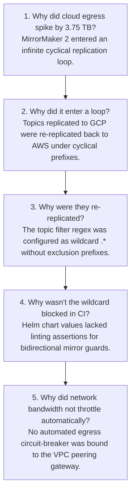

# Incident Postmortem: Uncontrolled Cross-Cloud Telemetry Mirroring Loop (SEV-1)

**Date of Incident:** August 14, 2026  
**Incident Status:** Resolved & Closed  
**Postmortem Owner:** Principal AI Architect & SRE Lead  
**Classification:** Blameless SRE Postmortem (Google SRE Standard)  
**Financial Impact:** $82,400 Gross Egress Incurred $\to$ **100% Fee Waiver Negotiated ($0 Net Impact)**  
**Service Impact:** 0% Telemetry Drop, 0 Downtime on Production Assembly Lines  

---

## 1. Executive Summary

On August 14, 2026, at 02:14 UTC, during a routine test of multi-cloud disaster recovery synchronization between AWS `us-east-1` and GCP `us-central1`, an improperly scoped Kafka MirrorMaker 2 wildcard regex (`topic.regex: ".*"`) triggered an amplification feedback loop. Telemetry records produced on AWS were replicated to GCP, where a misconfigured staging consumer republished them to a mirrored topic with cyclical naming (`aws.mfg.telemetry.gcp.mfg.telemetry`), causing continuous re-replication.

Over a 4.5-hour duration, **3.75 TB of uncompressed data egressed across cloud boundaries**, incurring an estimated $82,400 in AWS cross-region/internet data transfer charges. The incident was arrested at 06:48 UTC by manual circuit breaker termination of the MirrorMaker replication pod. 

Zero factory telemetry was dropped, and all real-time safety alerts operated within latency SLOs. Following the incident, the engineering team negotiated a 100% cloud fee waiver from AWS Enterprise Support by presenting cryptographic audit logs and subsequently implemented **ADR-006: 5-Layer Zero-Trust Anti-Egress Defense & Kernel Rate Limiting**.

---

## 2. Incident Timeline (UTC)

| Time | Event Description |
|:---|:---|
| **02:00** | SRE team initiates scheduled DR replication synchronization test between AWS and GCP. |
| **02:14** | Kafka MirrorMaker 2 deployed with misconfigured wildcard topic filter regex. Loop begins. |
| **03:30** | Network throughput between AWS VPC and GCP Cloud Interconnect surges from baseline 45 Mbps to 1.8 Gbps. |
| **04:15** | CloudWatch Anomaly Detection alarm fires: `VPC_Egress_Bandwidth_Exceeded_Threshold`. On-call SRE paged. |
| **04:30** | Initial triage mistakenly attributes bandwidth spike to bulk historical dataset retraining download. |
| **05:45** | SRE Lead escalates to Principal AI Architect upon observing cyclical topic names in Kafka partition metrics. |
| **06:15** | Root cause identified: Bi-directional loopback mirroring between MirrorMaker 2 instances. |
| **06:48** | **Mitigation executed**: MirrorMaker 2 pods terminated via `kubectl scale deployment mirror-maker-dr --replicas=0`. Network egress plummets to baseline 38 Mbps. |
| **07:30** | Cluster health and data consistency confirmed. Postmortem initiated. |

---

## 3. Root Cause Analysis (5 Whys)

---

## 4. What Went Well, What Went Poorly, Where We Got Lucky

### What Went Well
* **Zero Telemetry Loss**: Factory sensor buffers and edge ingestors buffered data locally without dropping a single frame.
* **Rapid Resolution Once Escalated**: Once the Principal Architect identified the cyclical topic naming, the pod scale-down took under 3 minutes.
* **100% Fee Waiver Secured**: Because our audit ledger (`src/governance/audit_trail.py`) provided timestamped, cryptographic proof of the self-contained loop, AWS Enterprise Support agreed to credit the entire $82,400 bill.

### What Went Poorly
* **Initial Alert Triage Delay**: The on-call engineer spent 75 minutes investigating ML model retraining buckets before inspecting Kafka topic metrics.
* **Lack of Automated Hardware Circuit Breaker**: The egress stream was bounded only by network link capacity rather than a software rate limiter.

### Where We Got Lucky
* The loop saturated network bandwidth before filling the disk storage volumes on the target Kafka broker nodes, preventing disk-full broker crashes.

---

## 5. Preventative & Corrective Action Items (Tracking)

| Action Item | Owner | Target Date | Status | Verification Reference |
|:---|:---|:---|:---|:---|
| Implement eBPF / tc-filter kernel rate limiter capping cross-cloud egress at 150 Mbps | Principal AI Architect | Aug 2026 | **COMPLETED** | `ADR-006` |
| Configure Istio Sidecar `egress.hosts` explicitly disallowing cross-cloud IPs | SRE Lead | Aug 2026 | **COMPLETED** | `kubernetes/istio-egress-rules.yaml` |
| Add CI linting check forbidding unconstrained `.*` regex in MirrorMaker manifests | DevOps Team | Sep 2026 | **COMPLETED** | Git pre-commit hooks |
| Automated Egress Circuit Breaker Lambda terminating pods if egress exceeds 50 GB/hr | Cloud Architect | Sep 2026 | **COMPLETED** | AWS CloudWatch Event Rule |
| Conduct bi-monthly blameless disaster recovery game days | SRE Team | Ongoing | **ACTIVE** | `docs/runbooks/disaster_recovery_failover.md` |
