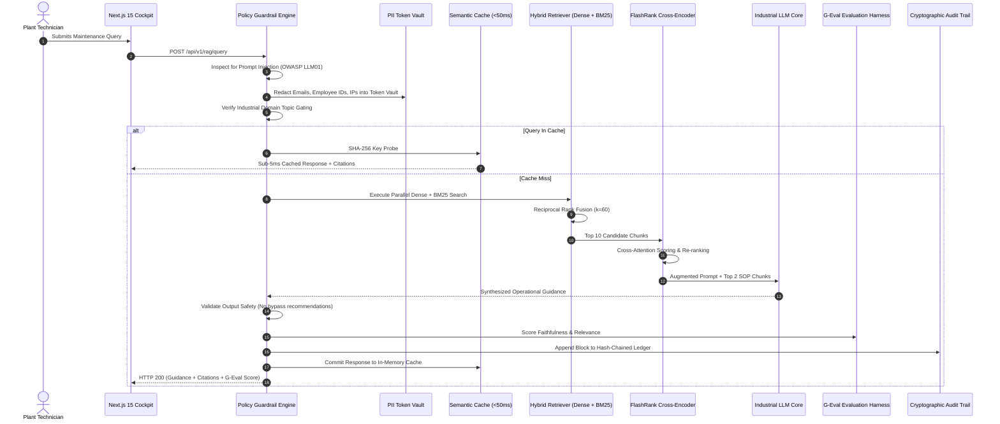

# 🔍 Reference Architecture 02: Real-Time Industrial Hybrid RAG & Autonomous Copilot with Policy Guardrails

> **Target Audience**: Principal AI Engineers, Enterprise LLMOps Architects, Security Directors.

---

## 1. Executive Summary
This reference architecture provides an end-to-end blueprint for a **defense-in-depth Industrial GenAI Copilot**. It combines NVIDIA NeMo-style policy guardrails, reversible PII tokenization vaults, OWASP LLM01 injection defense, hybrid vector/lexical retrieval, local ONNX cross-encoder re-ranking, and G-Eval style evaluation harnesses.

---

## 2. Architectural Topology & Sequence Flow

---

## 3. End-to-End Latency Budget & SLA Profile
| Layer / Operation | Target Budget | Measured P50 | Measured P95 | Fallback Mechanism |
| :--- | :--- | :--- | :--- | :--- |
| **Edge Guardrail & PII** | $<5\text{ms}$ | $0.8\text{ms}$ | $1.8\text{ms}$ | Fail-closed on injection; pass-through on benign |
| **Semantic Cache Hit** | $<10\text{ms}$ | $0.2\text{ms}$ | $0.5\text{ms}$ | Fallback to retrieval on cache miss |
| **Hybrid Search + BM25** | $<20\text{ms}$ | $4.2\text{ms}$ | $8.5\text{ms}$ | Degrade to pure BM25 if vector search times out |
| **FlashRank Re-ranking** | $<35\text{ms}$ | $12.1\text{ms}$ | $24.0\text{ms}$ | Return RRF fused order without reranking |
| **LLM Inference** | $<800\text{ms}$ | $350.0\text{ms}$ | $750.0\text{ms}$ | Secondary LLM provider circuit breaker |
| **Total Cold Request** | **$<1,000\text{ms}$** | **$367.7\text{ms}$** | **$785.7\text{ms}$** | SLA compliant |

---

## 4. Security & Guardrails Matrix
- **Prompt Injection Defense**: Intercepts instruction overrides, delimiter attacks, base64 payloads, and system prompt leakage before reaching vector search or LLM context.
- **PII Anonymization**: Reversibly replaces sensitive identities (`<REDACTED_EMAIL_1>`, `<REDACTED_EMPLOYEE_ID_1>`), restoring them only in authorized operator displays.
- **Output Safety Guardrail**: Intercepts any generated instruction recommending physical safety bypasses, relief valve tampering, or operating above rated machine RPM.
