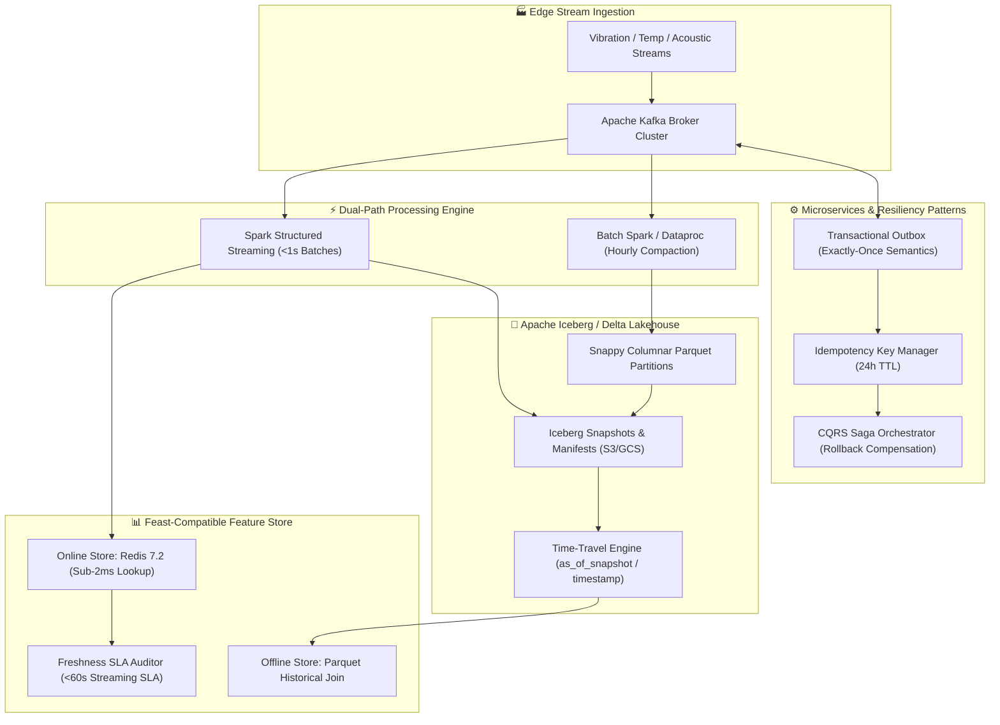

# 🗄️ Reference Architecture 03: Petabyte-Scale Lakehouse & Event-Driven Outbox

> **Target Audience**: Principal Data Engineers, Chief Data Officers, Distributed Systems Architects.

---

## 1. Executive Summary
This reference architecture provides a unified data platform and event-driven microservices blueprint for smart manufacturing. It combines **Apache Iceberg / Delta Lakehouse** storage with a **Transactional Outbox Pattern**, a **Feast-compatible dual feature store**, and **Distributed Saga Orchestration** to achieve sub-second streaming ingestion, point-in-time correctness, and backward-compensating rollbacks across distributed plant systems.

---

## 2. Architecture Diagram & Event Topography

---

## 3. Data Freshness SLAs & Feature Engineering Profile
| Pipeline Path | Data Modality | Freshness SLA | Processing Engine | Storage Target |
| :--- | :--- | :--- | :--- | :--- |
| **Streaming Hot Path** | Vibration RMS, Spindle RPM, Bearing Temp | **$<60\text{ seconds}$** | Kafka + Micro-batches | Redis 7.2 Online Feature Store |
| **Batch Historical Path** | 24-hr Aggregate Statistics, Tool Wear Indices | **$<24\text{ hours}$** | PySpark / Dataproc Serverless | Apache Iceberg / Delta Lakehouse |
| **Vision Defect Archive** | Stamped Casings Raw Imagery (10GbE) | **$<5\text{ minutes}$** | MinIO Multipart Upload | S3/GCS Coldline Storage Tier |

---

## 4. Saga Orchestration Failure Mode Case Study
When an imminent spindle failure is detected:
1. **Forward Path**: Anomaly Flagged $\to$ Inventory Reserved $\to$ Work Order Dispatched $\to$ Line Throttled.
2. **Failure Injection**: ERP throws `INSUFFICIENT_STOCK_ERROR` on bearing part `SKF-6205`.
3. **Compensating Rollback**: The Saga Orchestrator catches the exception, cancels the incomplete work order, releases inventory holds, and escalates an urgent procurement alarm to the plant floor supervisor without leaving dirty state.
