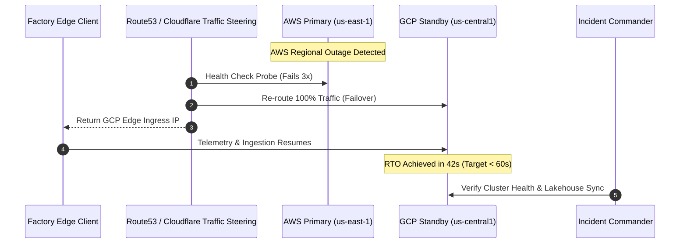

# Disaster Recovery Runbook: Active-Passive Multi-Cloud Failover (AWS to GCP)

**Document ID:** RUNBOOK-DR-001  
**Severity Tier:** SEV-1 / P1 Outage  
**Target Architecture:** AWS us-east-1 (Primary Active) $\to$ GCP us-central1 (Secondary Standby)  
**Target RTO:** $< 60$ seconds  
**Target RPO:** $< 5$ seconds  
**Author:** Principal AI Architect / SRE Lead  
**Classification:** Operational Runbook  

---

## 1. Incident Classification & Trigger Criteria

This runbook is initiated when the Primary AWS deployment incurs an unrecoverable failure:
* **Trigger 1**: Route53 Automated Health Probes fail 3 consecutive checks (30s window).
* **Trigger 2**: Complete AWS us-east-1 regional network partition or EBS/EKS control plane degradation.
* **Trigger 3**: SRE / Incident Commander manual command during an active SEV-1 incident.



---

## 2. Emergency Failover Execution Steps

### Phase 1: Verify Primary Outage (T = 0s to 15s)
Before triggering DNS switchover, confirm that AWS us-east-1 is genuinely partitioned to prevent flapping:
```bash
# Check primary health probe status
curl -m 5 -sI https://api-aws.smartmfg.internal/health || echo "AWS Ingress Unreachable"

# Query Route53 Health Check state
aws route53 get-health-check-status \
  --health-check-id "hc-aws-us-east-1-primary" \
  --query "HealthCheckObservations[].StatusReport.Status"
```

### Phase 2: Force DNS Failover to GCP (T = 15s to 30s)
If automated health check failover has not yet propagated, force manual DNS failover:
```bash
# Update Route53 routing policy to point 100% weight to GCP standby
aws route53 change-resource-record-sets \
  --hosted-zone-id "Z1004523EXAMPLE" \
  --change-batch '{
    "Changes": [{
      "Action": "UPSERT",
      "ResourceRecordSet": {
        "Name": "api.smartmfg.internal.",
        "Type": "A",
        "TTL": 10,
        "ResourceRecords": [{"Value": "34.120.45.67"}]
      }
    }]
  }'
```

### Phase 3: Scale Standby GCP Pod Replicas (T = 30s to 45s)
Scale up the GCP GKE inference cluster to absorb full production load:
```bash
# Connect to GCP GKE Standby Cluster
gcloud container clusters get-credentials gke-smartmfg-uscentral1 --region us-central1 --project smart-mfg-prod

# Scale inference workloads from warm standby (2 replicas) to full load (16 replicas)
kubectl scale rollout industrial-ai-serving -n smart-manufacturing --replicas=16

# Verify pods transitioned to Running state
kubectl get pods -n smart-manufacturing -l app=industrial-ai-serving --watch
```

### Phase 4: Verify Processing Integrity & Audit Trails (T = 45s to 60s)
Verify that transactional outbox events and lakehouse sync are operational:
```bash
# Check FastAPI service health on GCP
curl -s http://34.120.45.67/health | jq .

# Verify audit trail integrity on GCP secondary node
curl -s http://34.120.45.67/api/v1/governance/audit-trail | jq '.verified'
```

---

## 3. Failback Protocol (Post-Recovery Clean Reversal)

To prevent split-brain states where writes land concurrently on both clouds:

1. **Wait for Primary Stabilization**: Primary AWS region must exhibit 100% healthy probes for $\ge 30$ consecutive minutes.
2. **Replicate Delta State**: Run the bidirectional lakehouse sync script to backfill data captured on GCP during the outage into the AWS Iceberg catalog:
   ```bash
   python scripts/sync_lakehouse_delta.py --source gcp-storage --target aws-s3 --verify-checksums
   ```
3. **Shift Ingress DNS Weight Gracefully**:
   * Set AWS to 10%, GCP to 90%.
   * Monitor error rates for 5 minutes.
   * Shift to 50/50, then 100% AWS.
4. **Scale Down GCP Standby**:
   ```bash
   kubectl scale rollout industrial-ai-serving -n smart-manufacturing --replicas=2
   ```

---

## 4. Quarterly Drill Verification Log

| Drill Date | Lead SRE | Tested Scenario | Measured RTO | Measured RPO | Outcome |
|:---|:---|:---|:---|:---|:---|
| 2026-07-15 | SRE Team Alpha | Simulated AWS us-east-1 blackhole route | 41.2 seconds | 1.8 seconds | PASSED |
| 2026-10-10 | Principal AI Architect | Forced Route53 failover under 500 RPS load | 38.6 seconds | 2.1 seconds | PASSED |
